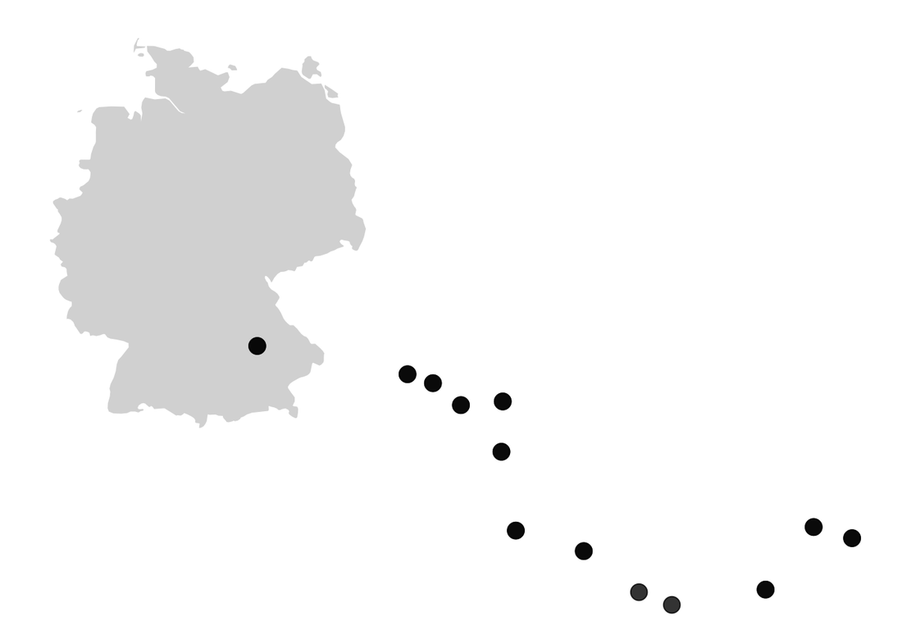
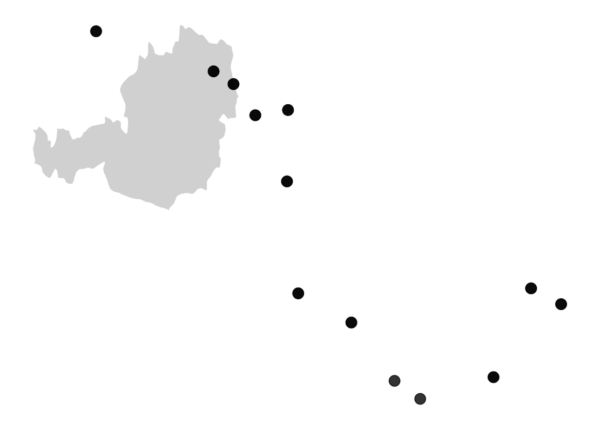
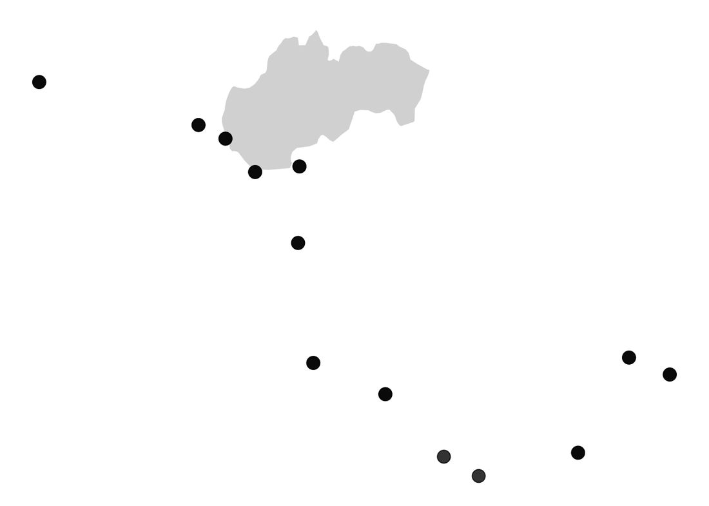
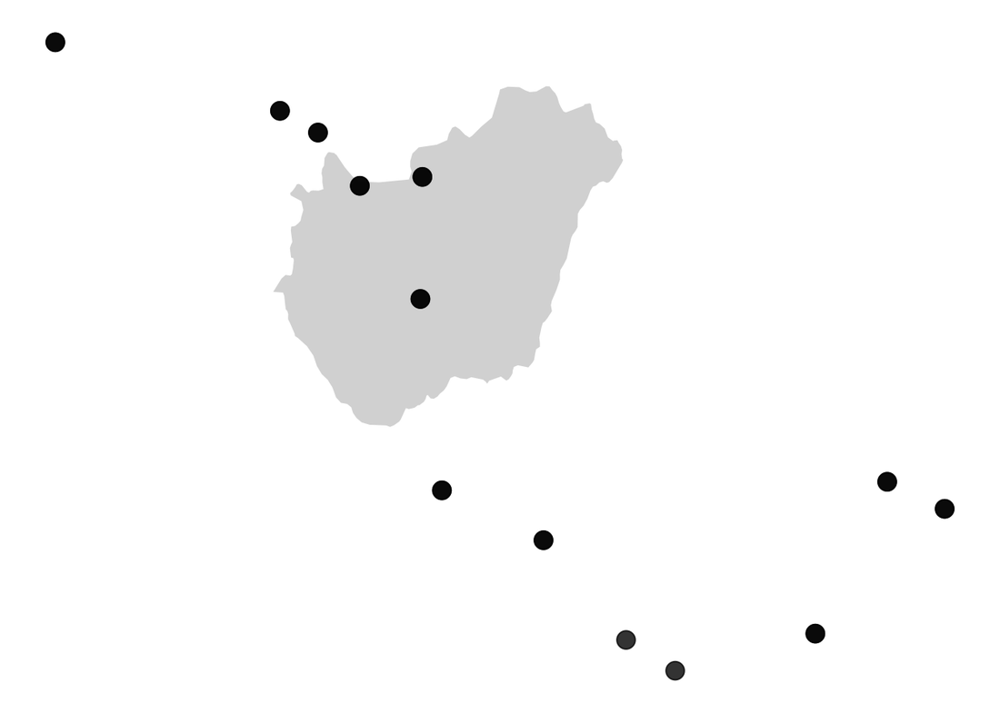
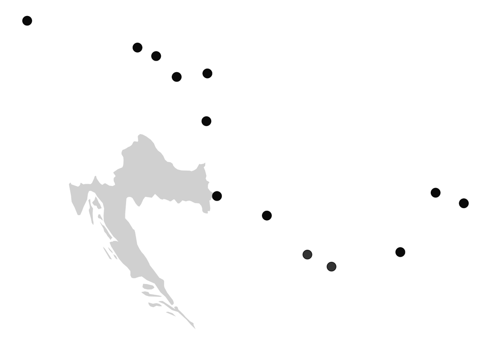
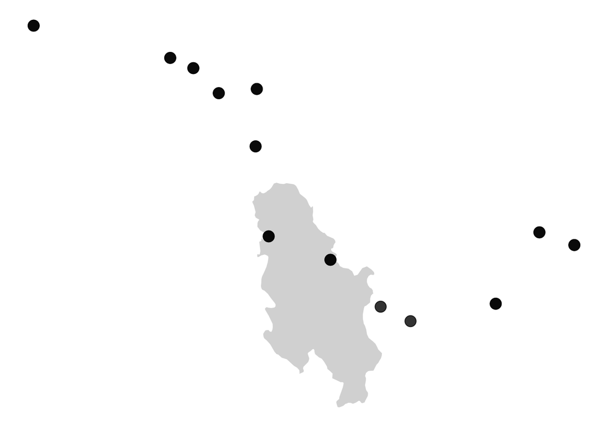
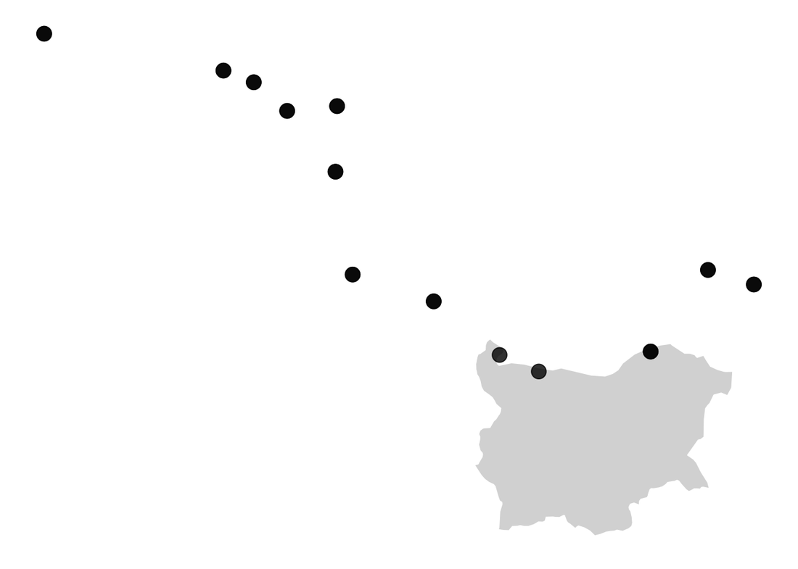
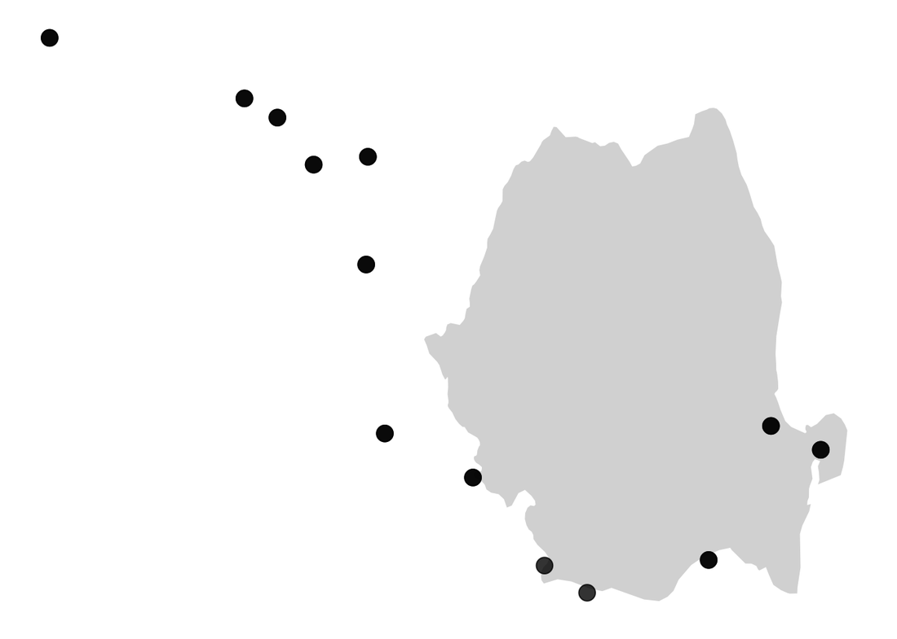

# Day 2 - Targeted sequencing analysis with DADA2

## Learning outcomes

**After having completed this chapter you will be able to:**

* Process Illumina paired-end 16S amplicon (eDNA) reads with the DADA2 pipeline: quality assessment, filtering, error correction, merging, chimera removal and taxonomy assignment.
* Build a Phyloseq object from the DADA2 outputs (ASV table and taxonomy) and the sample metadata.
* Assess the sequencing effort with rarefaction curves and estimate α-diversity (Shannon, Simpson, Chao1).
* Explore β-diversity with an NMDS ordination and barplots of the most abundant taxa.
* Map the samples geographically and run a LEfSe analysis to identify taxa that discriminate the sampled fractions.

## Objective

<p style='text-align: justify;'>This session introduces a **targeted-amplicon (16S rRNA) analysis** of environmental DNA (eDNA) samples collected along the Danube river, using the R package DADA2 and the downstream analysis toolbox PhyloSeq. You start from raw Illumina paired-end reads, go through the classical denoising pipeline, and finish with ecological and statistical interpretation of the recovered ASVs (Amplicon Sequence Variants).</p>

## About the data

<p style='text-align: justify;'>The dataset is extracted from a study of the bacterial diversity along the Danube river, published by [Savio et al. (2015)](https://ami-journals.onlinelibrary.wiley.com/doi/10.1111/1462-2920.12886) (BioProject accession [PRJNA256993](https://www.ncbi.nlm.nih.gov/bioproject/PRJNA256993)). We provide a subset of **24 samples** to fit the schedule of the session. The samples were amplified with primers **Bakt_341F** and **Bakt_805R** (V3–V4 region of the 16S rRNA gene), using 2×250 bp paired-end Illumina reads. Samples were collected at different positions along the river (downstream distance in km, `pos_km`), depths and size fractions (0.2 µm vs. 3 µm). A preview of the sample metadata is shown below:</p>

| Code | Collection date | Depth | Fraction | Country | Latitude | Longitude | pos_km |
|------|-----------------|-------|----------|---------|----------|-----------|--------|
| II001A | 13.08.07 | 0.5 | 3 | Germany | 48.31073 | 9.86037 | 2600 |
| II002F | 15.08.07 | 2 | 0.2 | Germany | 48.91502 | 11.8685 | 2412 |
| II002A | 15.08.07 | 2 | 3 | Germany | 48.91502 | 11.8685 | 2412 |
| II003F | 15.08.07 | 2 | 0.2 | Germany | 48.97589 | 12.35567 | 2354 |
| II003A | 15.08.07 | 2 | 3 | Germany | 48.97589 | 12.35567 | 2354 |
| II004F | 16.08.07 | 2 | 0.2 | Germany | 48.83379 | 12.93476 | 2287 |
| II004A | 16.08.07 | 2 | 3 | Germany | 48.83379 | 12.93476 | 2287 |
| II005A | 16.08.07 | 1.8 | 3 | Germany | 48.77990 | 13.0059 | 2278 |
| II007F | 17.08.07 | 7 | 0.2 | Germany | 48.52488 | 13.69373 | 2204 |
| II008F | 18.08.07 | 7 | 0.2 | Austria | 48.25501 | 14.41705 | 2120 |
| II089F | 23.09.07 | 10 | 0.2 | Romania | 45.30175 | 27.99807 | 167 |
| II009A | 18.08.07 | 10 | 3 | Austria | 48.19670 | 15.05291 | 2061 |

<p style='text-align: justify;'>**Part I** follows the steps for processing the Illumina reads: QC, cleaning, filtering, error correction, merging, and taxonomy assignment, using the DADA2 pipeline described in the [DADA2 tutorial](https://benjjneb.github.io/dada2/tutorial.html). **Part II** uses these results for the downstream analysis: α-diversity, β-diversity, various plots, geographic localisation, and linear discriminant analysis (LEfSe) to highlight interesting differences and taxa.</p>

## Material

* The cleaned reads (`EU2cleanreads` folder, not hosted on this website because of their size) — download and extract them from the **Moodle page**.
* The sample metadata: [:fontawesome-solid-file-csv: PRJNA256993_SraRunTable.txt](../assets/data/PRJNA256993_SraRunTable.txt){: .md-button }
* The DADA2 outputs pre-computed for you (needed for Part II): [:fontawesome-solid-database: seqtab2.nochim.rds](../assets/data/seqtab2.nochim.rds){: .md-button } [:fontawesome-solid-database: taxa.rds](../assets/data/taxa.rds){: .md-button }
* The Silva reference database v138 for taxonomy assignment (download separately, it is about 150 MB):
  [silva_nr99_v138.1_wSpecies_train_set.fa.gz](https://zenodo.org/records/4587955){: .md-button }

!!! info "Skipping Part I?"
    If you prefer (or reach the end of the session), you can skip the DADA2 denoising step and load directly the pre-computed `seqtab2.nochim.rds` and `taxa.rds` files to start the downstream analysis of **Part II**.

## Part I - Sequence processing with DADA2

<p style='text-align: justify;'>For the first part we will process the 24 samples of 16S amplicon reads (2×250 bp paired-end Illumina reads) that have already been trimmed of primers and adapters by cutadapt. The workflow follows the steps of the [DADA2 tutorial](https://benjjneb.github.io/dada2/tutorial.html): quality assessment, filtering, learning the error rates, denoising, merging paired reads, chimera removal and taxonomy assignment. DADA2 implements a model-based error-correction method that resolves Amplicon Sequence Variants (ASVs) differing by just a single nucleotide.</p>

### Experimental setting

<p style='text-align: justify;'>Open RStudio, create a working directory (we will use `~/Desktop/eDNAworkshop2024`) and place the reads in a subdirectory named `EU2cleanreads`. Download the metadata file from the [Material](#material) section and copy it to the working directory. Then run:</p>

```r title="Experimental setting" linenums="1"
options(conflicts.policy = list(warn = FALSE)) #this line removes all warnings of function masking
library(dada2)
packageVersion("dada2")

#change the PATH according to your setting
setwd("~/Desktop/eDNAworkshop2024")
path <- "~/Desktop/eDNAworkshop2024/EU2cleanreads"
list.files(path)

# Metadata available
design_info<-read.table("PRJNA256993_SraRunTable.txt", sep="\t", header=TRUE)
knitr::kable(design_info[seq(1,12),c(3,7,6,9,10,11,8)], format="html", align=rep('c', 10))

# Forward and reverse fastq filenames have format: SAMPLENAME_1trim.fastq.gz and SAMPLENAME_2trim.fastq.gz
fnFs <- sort(list.files(path, pattern="_1trim.fastq.gz", full.names = TRUE))
fnRs <- sort(list.files(path, pattern="_2trim.fastq.gz", full.names = TRUE))

# Extract sample names, assuming filenames have format: SAMPLENAME_XXX
sample.names <- sapply(strsplit(basename(fnFs), "_"), `[`, 1)
```

### Data QC: quality profiles

<p style='text-align: justify;'>DADA2 includes a plotting function to inspect the quality of the reads (analogous to what you did with FastQC in [Day 1](day1_quality_control.md)). Here we plot the quality profiles of the first forward and reverse reads:</p>

```r title="Quality profiles" linenums="1"
#now we plot the QC of the first two Forward and Reverse reads
plotQualityProfile(fnFs[1:2])
plotQualityProfile(fnRs[1:2])

#one can see that the QC plot show good quality for Forward reads and a lower quality for Reverse reads after position 230.
```

<figure markdown align="center">
  
  <figcaption>Quality profiles of the first two forward reads.</figcaption>
</figure>

<figure markdown align="center">
  
  <figcaption>Quality profiles of the first two reverse reads. The quality drops after position ~230.</figcaption>
</figure>

### Filtering and truncation of reads

<p style='text-align: justify;'>We filter the reads with the standard parameters: `maxN=0` (DADA2 requires no Ns), `truncQ=2`, `rm.phix=TRUE` and `maxEE=2`. The `maxEE` parameter sets the maximum number of "expected errors" allowed in a read, which is a better filter than simply averaging quality scores. In this case we do not truncate the reads (`truncLen=0`) but in other cases it could be adjusted, e.g. `truncLen=c(220,160)`.</p>

```r title="Filter and trim" linenums="1"
# Filter and place filtered files in filtered/ subdirectory
filtFs <- file.path(path, "filtered", paste0(sample.names, "_F_filt.fastq.gz"))
filtRs <- file.path(path, "filtered", paste0(sample.names, "_R_filt.fastq.gz"))
names(filtFs) <- sample.names
names(filtRs) <- sample.names

out <- filterAndTrim(fnFs, filtFs, fnRs, filtRs, truncLen=0,
                     maxN=0, maxEE=c(2,2), truncQ=2, rm.phix=TRUE,
                     compress=TRUE, multithread=TRUE) # On Windows set multithread=FALSE
head(out)
```

### Learn the error rates and correct the reads

!!! warning "Slow step"
    This part is relatively slow (about 5 min on a laptop).

<p style='text-align: justify;'>DADA2 learns the error rates from the data itself using a machine-learning algorithm, once for the forward and once for the reverse reads:</p>

```r title="Learn the error rates" linenums="1"
errF <- learnErrors(filtFs, multithread=TRUE)
errR <- learnErrors(filtRs, multithread=TRUE)

plotErrors(errF, nominalQ=TRUE)
plotErrors(errR, nominalQ=TRUE)

#The error rates for each possible transition (A->C, A->G, ...) are shown. Points are the
#observed error rates for each consensus quality score. The black line shows the estimated error
#rates after convergence of the machine-learning algorithm. The red line shows the error rates
#expected under the nominal definition of the Q-score.
```

<figure markdown align="center">
  
  <figcaption>Estimated error rates for the forward reads. The black line (learned) fits the observed points well.</figcaption>
</figure>

<figure markdown align="center">
  
  <figcaption>Estimated error rates for the reverse reads.</figcaption>
</figure>

<p style='text-align: justify;'>Everything looks reasonable, so we can proceed with confidence and apply the core sample-inference algorithm:</p>

```r title="Denoise the reads" linenums="1"
#We are now ready to apply the core sample DADA2 inference algorithm to the filtered and trimmed sequence data.
dadaFs <- dada(filtFs, err=errF, multithread=TRUE, pool="pseudo")
dadaRs <- dada(filtRs, err=errR, multithread=TRUE, pool="pseudo")
dadaFs[[1]]
```

!!! info "Pooling samples"
    By default, the `dada` function processes each sample independently. Pooling information across samples can increase sensitivity to sequence variants that may be present at very low frequencies in multiple samples. `dada(..., pool=TRUE)` performs standard pooled processing, whereas `dada(..., pool="pseudo")` (used above) shares information between samples while processing them independently, approximating pooled inference in linear time. You'll find an explanation [here](https://benjjneb.github.io/dada2/pseudo.html).

### Merging the reads

<p style='text-align: justify;'>Now we merge the forward and reverse reads into a single amplicon sequence and write a FASTA file with the merged sequences per sample:</p>

```r title="Merge paired reads" linenums="1"
merged <- mergePairs(dadaFs, filtFs, dadaRs, filtRs, verbose=TRUE)

# Inspect the merger data.frame from the first sample
head(merged[[1]])

#write Fasta files of merged sequences
for(nm in names(merged)) {
  mrg <- merged[[nm]]
  if(nrow(mrg) > 0) {
    uniquesToFasta(mrg, paste0("merged_", nm, ".fasta"))
  }
}
```

### Construct the sequence table

<p style='text-align: justify;'>We build a table of counts for all merged sequences (one column per ASV) and inspect the distribution of sequence lengths:</p>

```r title="Sequence table" linenums="1"
# We make a table of counts for all sequences merged
seqtab <- makeSequenceTable(merged)
dim(seqtab)

# Inspect distribution of sequence lengths
table(nchar(getSequences(seqtab)))
```

!!! info "Cutting the band"
    You can remove non-target-length sequences from the sequence table, e.g. `seqtab2 <- seqtab[,nchar(colnames(seqtab)) %in% 250:262]`. This is analogous to "cutting a band" in-silico to get amplicons of the targeted length. Here we see multiple peaks (not a good sign), so we cut around the expected V3–V4 length:

```r title="Keep target-length ASVs" linenums="1"
#here we see that we have multiple peaks... not a good sign, anyway we cut around them
seqtab2 <- seqtab[,nchar(colnames(seqtab)) %in% 450:481]
```

### Remove chimeras

<p style='text-align: justify;'>Chimeras are PCR artifacts that must be identified and removed. We use the consensus method and check the proportion of reads kept:</p>

```r title="Remove chimeras" linenums="1"
seqtab2.nochim <- removeBimeraDenovo(seqtab2, method="consensus", multithread=TRUE, verbose=TRUE)
dim(seqtab2.nochim)
sum(seqtab2.nochim)/sum(seqtab2)

#We save the final table
write.table(t(seqtab2.nochim), "seqtab-nochim.txt", sep="\t", row.names=TRUE, col.names=NA, quote=FALSE)
```

### Track reads through the pipeline

<p style='text-align: justify;'>It is important to keep track of how many reads survive each step. We build a table that summarises the number of reads at each stage of the pipeline:</p>

```r title="Track read counts" linenums="1"
getN <- function(x) sum(getUniques(x))
track <- cbind(out, sapply(dadaFs, getN), sapply(dadaRs, getN), sapply(merged, getN), rowSums(seqtab2.nochim))
# If processing a single sample, remove the sapply calls: e.g. replace sapply(dadaFs, getN) with getN(dadaFs)

colnames(track) <- c("input", "filtered", "denoisedF", "denoisedR", "merged", "nonchim")
rownames(track) <- sample.names
head(track)
```

<p style='text-align: justify;'>Looks good! We kept the majority of our raw reads, and there is no over-large drop associated with any single step.</p>

### Assign taxonomy

!!! warning "Slow step"
    This part is very slow: about 45 min on an old laptop! Once launched, go for a break.

<p style='text-align: justify;'>We assign a taxon to each ASV using the reference Silva database v138 (download it from the [Material](#material) section):</p>

```r title="Assign taxonomy" linenums="1"
#We assign a taxon for each ASV using the Reference Silva database v138
taxa <- assignTaxonomy(seqtab2.nochim, "~/Desktop/eDNAworkshop2024/silva_nr99_v138.1_wSpecies_train_set.fa.gz", multithread=TRUE)

taxa.print <- taxa # Removing sequence rownames for display only
rownames(taxa.print) <- NULL
head(taxa.print)

#save taxonomy assignment
write.table(t(taxa), "seqtab-taxa.txt", sep="\t", row.names=TRUE, col.names=NA, quote=FALSE)
#get representative sequences in FASTA
uniquesToFasta(seqtab2.nochim, fout='rep-seqs.fna', ids=colnames(seqtab2.nochim))

#save RDS files for second part
saveRDS(seqtab2.nochim, 'seqtab2.nochim.rds')
saveRDS(taxa, 'taxa.rds')
```

<p style='text-align: justify;'>This is the end of **Part I**. Move on to **Part II** for the downstream analysis.</p>

## Part II - Downstream analysis with PhyloSeq

<p style='text-align: justify;'>In this second part we analyse the DADA2 outputs with PhyloSeq and friends: α-diversity, β-diversity, barplots, geographic localisation and a LEfSe analysis. If you skipped Part I, load the pre-computed `seqtab2.nochim.rds` and `taxa.rds` files from the [Material](#material) section.</p>

### PhyloSeq setting

<p style='text-align: justify;'>We build a `phyloseq` object that combines the ASV count table, the sample metadata and the taxonomy table:</p>

```r title="Build the Phyloseq object" linenums="1"
#BiocManager::install("phyloseq")

options(conflicts.policy = list(warn = FALSE)) #this line removes all warnings of function masking
library(phyloseq, quietly = TRUE)
library(Biostrings, quietly = TRUE)
library(ggplot2, quietly = TRUE)
library(magrittr, quietly = TRUE)
library(vegan, quietly = TRUE)
library(sf)
sf::sf_use_s2(FALSE)
library(mapview)
library(magick)
theme_set(theme_bw())

#CHANGE PATH according to your settings
setwd("~/Desktop/eDNAworkshop2024")
samdf <- read.delim("PRJNA256993_SraRunTable.txt")
rownames(samdf)<-samdf$Run
samdf<-samdf[,-1]

#convert Collection_Date to a "date"
samdf$Collection_Date<-as.Date(samdf$Collection_Date, "%d.%m.%Y") %>% format("20%y%m%d") %>% as.Date("%Y%m%d")

#read RDS data
seqtab2.nochim <- readRDS("seqtab2.nochim.rds")
taxa <- readRDS("taxa.rds")

#build phyloseq obj without tree
ps <- phyloseq(otu_table(seqtab2.nochim, taxa_are_rows=FALSE),
               sample_data(samdf),
               tax_table(taxa))

#verify the phyloseq object
ps
```

### Rarefaction curves & richness plots

<p style='text-align: justify;'>Plotting the rarefaction curve is a quality check to verify that we reached saturation of the sampling. We then add the ASV sequences to the object and rename the ASVs, and check the α-diversity with several richness indices, either by Depth or by Fraction, along the river:</p>

```r title="Rarefaction and richness" linenums="1"
#plotting the rarefaction curve is a quality check to verify that we reached saturation of the sampling
rarecurve(data.frame(otu_table(ps, taxa_are_rows = 1)), step=100, col="blue", lwd=2, ylab="ASVs", main="Rarefaction Curve for all samples")

#extract ASV sequences and add them to the phyloseq object renaming the ASVs
dna <- Biostrings::DNAStringSet(taxa_names(ps))
names(dna) <- taxa_names(ps)
ps <- merge_phyloseq(ps, dna)
taxa_names(ps) <- paste0("ASV", seq(ntaxa(ps)))


#Now we check the alpha diversity by plotting different richness indices either by Depth or by Fraction vs the position along the river
plot_richness(ps, x="pos_km", color="factor(Depth)", measures=c("Shannon", "Simpson", "Chao1"))
plot_richness(ps, x="pos_km", color="factor(Fraction)", measures=c("Shannon", "Simpson", "Chao1"))
```

<figure markdown align="center">
  
  <figcaption>Rarefaction curves for all samples. When is the saturation reached?</figcaption>
</figure>

<figure markdown align="center">
  
  <figcaption>Alpha diversity indices along the river, coloured by Depth.</figcaption>
</figure>

<figure markdown align="center">
  
  <figcaption>Alpha diversity indices along the river, coloured by Fraction.</figcaption>
</figure>

!!! question "Question"
    Can you see an effect?

### Shannon plot with regression

<p style='text-align: justify;'>We now focus on the Shannon diversity, plotting the regression line by Fraction size along the river:</p>

```r title="Shannon diversity with regression" linenums="1"
#OK we will focus on the Shannon diversity, but plotting the regression line by Fraction size
ps_alpha_div <- estimate_richness(ps, split = TRUE, measure = "Shannon")
sample_metadata = data.frame(sample_data(ps))
ps_alpha_div$Fraction = sample_metadata$Fraction[match(rownames(ps_alpha_div), rownames(sample_metadata))]
ps_alpha_div$pos_km = sample_metadata$pos_km[match(rownames(ps_alpha_div), rownames(sample_metadata))]

ps_alpha_small<-ps_alpha_div[ps_alpha_div$Fraction == '0.2',]
ps_alpha_large<-ps_alpha_div[ps_alpha_div$Fraction > '0.2',]
visuals = rbind(ps_alpha_small,ps_alpha_large)

#plot the regressions with confidence intervals
p3 <- ggplot(visuals, aes(x=pos_km, y=Shannon, group=visuals$Fraction, color=factor(visuals$Fraction))) +
  geom_point() +
  geom_smooth(data=visuals, method=lm , aes(x=pos_km, y=Shannon, group=visuals$Fraction, color=factor(visuals$Fraction)), fill="#99b3a2", se=TRUE, size=1) +
  labs(colour = "Fraction")
p3
```

<figure markdown align="center">
  
  <figcaption>Shannon diversity along the river with a regression line per Fraction.</figcaption>
</figure>

!!! question "Question"
    Do you see a clear separation of the Fraction?

### Beta diversity and barplots

<p style='text-align: justify;'>We transform the data to proportions (appropriate for Bray-Curtis distances) and ordinate the samples with a non-metric multidimensional scaling (NMDS). We also plot the genus and phylum abundance per sample:</p>

```r title="Beta diversity and barplots" linenums="1"
#Transform data to proportions as appropriate for Bray-Curtis distances
ps.prop <- transform_sample_counts(ps, function(otu) otu/(sum(otu)+1))
ord.nmds.bray <- ordinate(ps.prop, method="NMDS", distance="bray")
sample_data(ps.prop)$Fraction=as.character(sample_data(ps.prop)$Fraction)
plot_ordination(ps.prop, ord.nmds.bray, color="Fraction", title="Bray NMDS") + geom_point(size=3)

#Data exploration shows no clear separation

#Now we try to plot the Genus abundance by sample keeping only the first 20 most abundant taxa.
top20 <- names(sort(taxa_sums(ps), decreasing=TRUE))[1:20]
ps.top20 <- transform_sample_counts(ps, function(OTU) OTU/(sum(OTU)+1))
ps.top20 <- prune_taxa(top20, ps.top20)
plot_bar(ps.top20, x="BioSample", fill="Genus") + geom_bar(aes(color=Genus, fill=Genus), stat="identity", position="stack")

#plot Phylum abundance of first 1000 most abundant taxa
top1000 <- names(sort(taxa_sums(ps), decreasing=TRUE))[1:1000]
ps.top1000 <- transform_sample_counts(ps, function(OTU) OTU/(sum(OTU)+1))
ps.top1000 <- prune_taxa(top1000, ps.top1000)
plot_bar(ps.top1000, x="BioSample", fill="Phylum") + geom_bar(aes(color=Phylum, fill=Phylum), stat="identity", position="stack")
```

<figure markdown align="center">
  
  <figcaption>NMDS ordination of the samples using Bray-Curtis distances.</figcaption>
</figure>

<figure markdown align="center">
  
  <figcaption>Genus abundance per sample (top 20 most abundant taxa).</figcaption>
</figure>

<figure markdown align="center">
  
  <figcaption>Phylum abundance per sample (top 1000 most abundant taxa).</figcaption>
</figure>

!!! info "Interpretation"
    Many samples do not contain one of the 20 most abundant genera! However, some taxa are typical of fresh water (Acinetobacter, Flavobacter, Rhodoluna, Limnohabitans, Pseudarcicella, Sphingorhabdus) or sludge (Luteolibacter).

!!! question "Question"
    Are there differences?

### Phylogeo localisation

<p style='text-align: justify;'>What about the geographic localisation of the samples? We use the [`phylogeo`](http://zachcp.github.io/phylogeo/) package to map the sample coordinates to geographic maps:</p>

```r title="Geographic maps with phylogeo" linenums="1"
#What about the geographic localisation of the samples?
#Here we will use a package to map the sample coordinates to geographic maps.

#http://zachcp.github.io/phylogeo/
devtools::install_github("zachcp/phylogeo")
library(gridExtra, quietly = TRUE)
library(phylogeo, quietly = TRUE)

#map for each country
map_phyloseq(ps, region=c("Germany"))
map_phyloseq(ps, region=c("Austria"))
map_phyloseq(ps, region=c("Slovakia"))
map_phyloseq(ps, region=c("Hungary"))
map_phyloseq(ps, region=c("Croatia"))
map_phyloseq(ps, region=c("Serbia"))
map_phyloseq(ps, region=c("Bulgaria"))
map_phyloseq(ps, region=c("Romania"))
```

<p style='text-align: justify;'>This is what you should obtain for each country:</p>

<table>
  <tr>
    <td align="center"><figure><figcaption>Germany</figcaption></figure></td>
    <td align="center"><figure><figcaption>Austria</figcaption></figure></td>
    <td align="center"><figure><figcaption>Slovakia</figcaption></figure></td>
    <td align="center"><figure><figcaption>Hungary</figcaption></figure></td>
  </tr>
  <tr>
    <td align="center"><figure><figcaption>Croatia</figcaption></figure></td>
    <td align="center"><figure><figcaption>Serbia</figcaption></figure></td>
    <td align="center"><figure><figcaption>Bulgaria</figcaption></figure></td>
    <td align="center"><figure><figcaption>Romania</figcaption></figure></td>
  </tr>
</table>

<p style='text-align: justify;'>As this is not practical and frozen, we can map the samples on an interactive leaflet map, similar to Google Maps. Unfortunately the `htmlmap_phyloseq()` function is deprecated and cannot be used anymore, so we build the map with `sf` and `mapview`:</p>

```r title="Interactive map with mapview" linenums="1"
#As this is not practical and frozen, we will map on a leaflet map similar to googlemaps
#htmlmap_phyloseq(ps, size=3, color="red") #color="geo_loc_name_country")

#we can also color by country
#htmlmap_phyloseq(ps, size=10, color="geo_loc_name_country")

#unfortunately this function is deprecated and cannot be used anymore

metadata<-sample_data(ps)
longitude<-metadata$Longitude
latitude<-metadata$Latitude
my_sites<-data.frame(longitude,latitude)

my_sites<- sf::st_as_sf(my_sites, coords=c("longitude","latitude"), crs=4326)
mapview::mapview(my_sites)
```

### LEfSe analysis

<p style='text-align: justify;'>Can we identify taxa that are specific for the two fractions (0.2 µm vs. 3 µm)? We use LEfSe (**L**inear discriminant analysis **E**ffect **S**ize) on the genus table with the `microbiomeMarker` package:</p>

```r title="LEfSe analysis" linenums="1"
#Can we identify taxa that are specific for the two fractions?
#We will use LEfSe (Linear discriminant analysis Effect Size) to assess possible differences

#BiocManager::install("microbiomeMarker") #if needed
#remotes::install_github("yiluheihei/microbiomeMarker")
library(microbiomeMarker, quietly = TRUE)

sample_data(ps)$Fraction=as.character(sample_data(ps)$Fraction)
lef_out<-microbiomeMarker::run_lefse(ps, group="Fraction", taxa_rank="Genus")
microbiomeMarker::plot_ef_bar(lef_out)
```

<figure markdown align="center">
  
  <figcaption>LEfSe results: genera with a significant Linear Discriminant Analysis (LDA) effect size between the two fractions.</figcaption>
</figure>

<p style='text-align: justify;'>Some taxa are known from lakes, rivers or seas (CL500-29 marine group, Halioglobus, Polynucleobacter) or from sediment/water interfaces (Gemmatimonas, Opitutus, Brevundimonas, Ilumatobacter, Sediminibacterium, Solitalea), and even some potential pathogens (Roseomonas). The hgcl-clade group is typical of areas associated with urban and industrial activities.</p>

## Summary

<p style='text-align: justify;'>Several tools were introduced to analyse 16S amplicon sequences from different samples along 2,600 km of the Danube river. The first part related to processing of the read data: QC, cleaning, filtering, error correction, merging, and taxonomy assignment. The second part related to α-diversity, β-diversity, various plots, geographic localisation, and linear discriminant analysis to highlight some interesting differences and taxa.</p>

## Additional resources

<p style='text-align: justify;'>If you want to explore more in detail how you can expand your analysis, please check the following resources:</p>

* [DADA2 tutorial](https://benjjneb.github.io/dada2/tutorial.html)
* [DADA2 pseudo-pooling](https://benjjneb.github.io/dada2/pseudo.html)
* [Silva v138 DADA2 training data](https://zenodo.org/records/4587955)
* [Savio et al. (2015) - bacterial diversity along the Danube river](https://ami-journals.onlinelibrary.wiley.com/doi/10.1111/1462-2920.12886)
* [phylogeo](http://zachcp.github.io/phylogeo/)
* [microbiomeMarker](https://github.com/yiluheihei/microbiomeMarker)
* [Phyloseq tutorial](https://vaulot.github.io/tutorials/Phyloseq_tutorial.html)