# Day 2 - Targeted sequencing analysis

## Learning outcomes

**After having completed this chapter you will be able to:**

* Explain the principles of amplicon-based (targeted) metagenomics and the rationale behind marker gene selection (16S rRNA, ITS).
* Discuss how primer design, PCR amplification and library preparation introduce biases in targeted metagenomics.
* Contrast OTU- and ASV-based workflows and justify the choice between them.
* Process Illumina paired-end 16S amplicon (eDNA) reads with the DADA2 pipeline: quality assessment, filtering, error correction, merging, chimera removal and taxonomy assignment.
* Build a Phyloseq object from the DADA2 outputs (ASV table and taxonomy) and the sample metadata.
* Assess the sequencing effort with rarefaction curves and estimate α-diversity (Shannon, Simpson, Chao1).
* Explore β-diversity with an NMDS ordination and barplots of the most abundant taxa.
* Map the samples geographically and run a LEfSe analysis to identify taxa that discriminate the sampled fractions.

## Targeted sequencing (Introduction and theory)

### Principles of amplicon-based sequencing

Targeted (amplicon) metagenomics does not sequence all the DNA in a sample. Instead, it amplifies and sequences a **specific marker gene** present in all members of a target group, using PCR with primers that flank a conserved region. The variable regions between the primers then serve as a molecular fingerprint for taxonomic identification. Because only a tiny fraction of the community DNA is sequenced, amplicon approaches are cheap, tolerate low DNA yields and can reach very high numbers of samples. This great advantage comes at the price of capturing **who is there**, but generally not **what they can do**.

### Marker gene selection

The choice of marker gene defines the resolution and the scope of the study:

* **16S rRNA gene**: the standard marker for bacteria and archaea. Combines conserved regions (for universal primer binding) with nine variable regions (V1–V9) carrying taxonomic signal. Typical amplicons target V3–V4, V4 or V1–V2, ~250–450 bp.
* **ITS (Internal Transcribed Spacer)**: the official marker for fungi. Much more variable than 16S, which gives excellent species-level resolution but makes reference databases and primer specificity more challenging.
* **Other markers**: 18S rRNA for eukaryotes, _rpoB_/_gyrB_ for higher resolution in specific groups, or multi-marker panels.

### Primer design, PCR biases and library preparation

Every PCR step imprints itself on the data, and understanding these biases is essential to interpret the results correctly:

* **Primer coverage and specificity**: no primer pair is truly universal. Mismatches at the binding site cause systematic under-detection (or complete missing) of some taxa; _in silico_ coverage tests against reference databases should guide primer choice.
* **Amplification bias**: primers do not amplify all targets with equal efficiency; GC content, secondary structures and template length all play a role.
* **Chimeras**: partially extended molecules from one template can prime on another during later PCR cycles, creating artificial sequences that must be removed computationally.
* **Tag switching / index hopping**: sample cross-contamination on the sequencer, mitigated by unique dual indexes.
* **Library preparation strategies**: two-stage (2-step) PCR protocols (amplicon PCR + indexing PCR) are standard for Illumina sequencing; amplicon length must match the chosen read length so that paired reads overlap (e.g. V3–V4 ~460 bp with 2×250 bp reads).

!!! info "Design checklist"
    Whenever you design your own amplicon study, it is worthy to check: 
    
    * Which marker and variable region? Which primer pair (and its coverage)? 

    * How many negatives and mock communities? How many biological replicates? 

### OTUs vs ASVs

Two paradigms exist to turn raw amplicon reads into discrete features:

| | **OTUs** (Operational Taxonomic Units) | **ASVs** (Amplicon Sequence Variants) |
|---|---|---|
| Inference | Greedy clustering of reads at a similarity threshold (typically 97%) | Model-based denoising of exact sequences (error model per run) |
| Resolution | Genus-ish; single-nucleotide variants collapsed | Single-nucleotide resolution |
| Reproducibility | Depends on the dataset and algorithm (pipeline-specific) | Exact sequences, that make them comparable across studies |
| Noise handling | Abundance filters (e.g. remove singletons) | Probabilistic error and chimera removal |
| Example tools | UPARSE, VSEARCH, mothur | DADA2, UNOISE3, Deblur |

Modern amplicon workflows (and this course) use **ASVs**: they are more precise, reproducible and better suited for combining studies. 

In **Session 4** we will process real 16S reads into ASVs with DADA2 and interpret the resulting community tables ecologically.

## Session 3 - Targeted sequencing I

### Objective

This session introduces a **targeted-amplicon (16S rRNA) analysis** of environmental DNA (eDNA) samples collected along the Danube river, using the R package DADA2 and the downstream analysis toolbox PhyloSeq. You start from raw Illumina paired-end reads, go through the classical denoising pipeline, and finish with ecological and statistical interpretation of the recovered ASVs (Amplicon Sequence Variants).

### About the data

The dataset is extracted from a study of the bacterial diversity along the Danube river, published by [Savio et al. (2015)](https://ami-journals.onlinelibrary.wiley.com/doi/10.1111/1462-2920.12886) (BioProject accession [PRJNA256993](https://www.ncbi.nlm.nih.gov/bioproject/PRJNA256993)). **24 samples** are provided, amplified with primers **Bakt_341F** and **Bakt_805R** (V3–V4 region of the 16S rRNA gene), using 2×250 bp paired-end Illumina reads. Samples were collected at different positions along the river (downstream distance in km, `pos_km`), depths and size fractions (0.2 µm vs. 3 µm). A preview of the sample metadata is shown below:

??? abstract "Sample preview"
    | BioSample    | Fraction | Depth | Latitude | Longitude | pos_km | geo_loc_name_country |
    | ------------ | -------- | ----- | -------- | --------- | ------ | -------------------- |
    | SAMN02945797 | 3.0      | 0.5   | 48.31073 | 9.86037   | 2600   | Germany              |
    | SAMN02945798 | 0.2      | 2.0   | 48.91502 | 11.86850  | 2412   | Germany              |
    | SAMN02945799 | 3.0      | 2.0   | 48.91502 | 11.86850  | 2412   | Germany              |
    | SAMN02945800 | 0.2      | 2.0   | 48.97589 | 12.35567  | 2354   | Germany              |
    | SAMN02945801 | 3.0      | 2.0   | 48.97589 | 12.35567  | 2354   | Germany              |
    | SAMN02945802 | 0.2      | 2.0   | 48.83379 | 12.93476  | 2287   | Germany              |
    | SAMN02945803 | 3.0      | 2.0   | 48.83379 | 12.93476  | 2287   | Germany              |
    | SAMN02945804 | 3.0      | 1.8   | 48.77990 | 13.00590  | 2278   | Germany              |
    | SAMN02945805 | 0.2      | 7.0   | 48.52488 | 13.69373  | 2204   | Germany              |
    | SAMN02945806 | 0.2      | 7.0   | 48.25501 | 14.41705  | 2120   | Austria              |
    | SAMN02945807 | 0.2      | 10.0  | 45.30175 | 27.99807  | 167    | Romania              |
    | SAMN02945808 | 3.0      | 10.0  | 48.19670 | 15.05291  | 2061   | Austria              |

**Part I** follows the steps for processing the Illumina reads: QC, cleaning, filtering, error correction, merging, and taxonomy assignment, using the DADA2 pipeline described in the [DADA2 tutorial](https://benjjneb.github.io/dada2/tutorial.html). 

**Part II** uses these results for the downstream analysis: α-diversity, β-diversity, various plots, geographic localisation, and linear discriminant analysis (LEfSe) to highlight interesting differences and taxa.

### Material

Go to Zenodo (Record [23603524](https://zenodo.org/records/23603524)) and download the compressed folder. Decompress it on your local machine, you will find:

??? abstract "Directory content"
    ```bash title="Directory content"
    .
    ├── Environmental Microbiology - 2015 - Savio - Bacterial diversity along a 2600 km river continuum .pdf
    ├── EU2cleanreads
    │   ├── SRR1531610_1trim.fastq.gz
    │   ├── SRR1531610_2trim.fastq.gz
    │   ├── SRR1531611_1trim.fastq.gz
    │   ├── SRR1531611_2trim.fastq.gz
    │   ├── SRR1531619_1trim.fastq.gz
    │   ├── SRR1531619_2trim.fastq.gz
    │   ├── SRR1531622_1trim.fastq.gz
    │   ├── SRR1531622_2trim.fastq.gz
    │   ├── SRR1531625_1trim.fastq.gz
    │   ├── SRR1531625_2trim.fastq.gz
    │   ├── SRR1531628_1trim.fastq.gz
    │   ├── SRR1531628_2trim.fastq.gz
    │   ├── SRR1531629_1trim.fastq.gz
    │   ├── SRR1531629_2trim.fastq.gz
    │   ├── SRR1531633_1trim.fastq.gz
    │   ├── SRR1531633_2trim.fastq.gz
    │   ├── SRR1531644_1trim.fastq.gz
    │   ├── SRR1531644_2trim.fastq.gz
    │   ├── SRR1531645_1trim.fastq.gz
    │   ├── SRR1531645_2trim.fastq.gz
    │   ├── SRR1531660_1trim.fastq.gz
    │   ├── SRR1531660_2trim.fastq.gz
    │   ├── SRR1531661_1trim.fastq.gz
    │   ├── SRR1531661_2trim.fastq.gz
    │   ├── SRR1531674_1trim.fastq.gz
    │   ├── SRR1531674_2trim.fastq.gz
    │   ├── SRR1531675_1trim.fastq.gz
    │   ├── SRR1531675_2trim.fastq.gz
    │   ├── SRR1531689_1trim.fastq.gz
    │   ├── SRR1531689_2trim.fastq.gz
    │   ├── SRR1531690_1trim.fastq.gz
    │   ├── SRR1531690_2trim.fastq.gz
    │   ├── SRR1531700_1trim.fastq.gz
    │   ├── SRR1531700_2trim.fastq.gz
    │   ├── SRR1531707_1trim.fastq.gz
    │   ├── SRR1531707_2trim.fastq.gz
    │   ├── SRR1531708_1trim.fastq.gz
    │   ├── SRR1531708_2trim.fastq.gz
    │   ├── SRR1531715_1trim.fastq.gz
    │   ├── SRR1531715_2trim.fastq.gz
    │   ├── SRR1531718_1trim.fastq.gz
    │   ├── SRR1531718_2trim.fastq.gz
    │   ├── SRR1531721_1trim.fastq.gz
    │   ├── SRR1531721_2trim.fastq.gz
    │   ├── SRR1531722_1trim.fastq.gz
    │   ├── SRR1531722_2trim.fastq.gz
    │   ├── SRR1531727_1trim.fastq.gz
    │   └── SRR1531727_2trim.fastq.gz
    ├── EU2dada2downstream.html
    ├── EU2dada2downstream.Rmd
    ├── EU2dada2.html
    ├── EU2dada2.Rmd
    ├── PRJNA256993_SraRunTable.txt
    ├── rep-seqs.fna
    ├── seqtab2.nochim.rds
    ├── seqtab-nochim.txt
    ├── seqtab-taxa.txt
    ├── silva_nr99_v138.1_wSpecies_train_set.fa.gz
    └── taxa.rds
    ```   
    
What you find here:

* The cleaned reads (`EU2cleanreads`)
* The sample metadata (`PRJNA256993_SraRunTable.txt`)
* The DADA2 and taxonomy assignment outputs pre-computed for you, needed for Part II (`seqtab2.nochim.rds`, `seqtab2.nochim.rds`, `taxa.rds`, `rep-seqs.fna`)
* The [Silva reference database v138.1](https://www.arb-silva.de/) for taxonomy assignment (`silva_nr99_v138.1_wSpecies_train_set.fa.gz`)

!!! info "Skipping Part I?"
    If you prefer (or reach the end of the session), you can skip the DADA2 denoising step and load directly the pre-computed `seqtab2.nochim.rds` and `taxa.rds` files to start the downstream analysis of [**Part II**](./day2_targeted_amplification_analysis.md#session-4-targeted-sequencing-ii).

### Part I - Sequence processing with DADA2

For the first part we will process the 24 samples of 16S amplicon reads (2×250 bp paired-end Illumina reads) that have already been trimmed of primers and adapters by cutadapt. The workflow follows the steps of the [DADA2 tutorial](https://benjjneb.github.io/dada2/tutorial.html): quality assessment, filtering, learning the error rates, denoising, merging paired reads, chimera removal and taxonomy assignment. DADA2 implements a model-based error-correction method that resolves Amplicon Sequence Variants (ASVs) differing by just a single nucleotide.

#### Experimental setting

Open RStudio, and set the downloaded directory as working directoy (i.e. `~/Desktop/eDNAworkshop2026`). Create a new R file and start writing and executing the code as follows:

!!! bug "Install packages"
    Remember that before starting running the code you need to install the required packages.

    [:fontawesome-solid-file-code: Download the required packages script](../assets/code/required_packages.R){: .md-button }

!!! terminal "RStudio"
    ```r title="Experimental setting" linenums="1"
    options(conflicts.policy = list(warn = FALSE)) #this line removes all warnings of function masking
    library(dada2)
    packageVersion("dada2")

    #change the PATH according to your setting
    setwd("~/Desktop/eDNAworkshop2026")
    path <- "~/Desktop/eDNAworkshop2026/EU2cleanreads"
    list.files(path)

    # Metadata available
    design_info<-read.table("PRJNA256993_SraRunTable.txt", sep="\t", header=TRUE)
    design_info[seq(1,12),c(3,7,6,9,10,11,8)]

    # Forward and reverse fastq filenames have format: SAMPLENAME_1trim.fastq.gz and SAMPLENAME_2trim.fastq.gz
    fnFs <- sort(list.files(path, pattern="_1trim.fastq.gz", full.names = TRUE))
    fnRs <- sort(list.files(path, pattern="_2trim.fastq.gz", full.names = TRUE))

    # Extract sample names, assuming filenames have format: SAMPLENAME_XXX
    sample.names <- sapply(strsplit(basename(fnFs), "_"), `[`, 1)
    ```

#### Data QC: quality profiles

DADA2 includes a plotting function to inspect the quality of the reads (analogous to what you did with FastQC in [Day 1](day1_introduction_quality_control.md)). Here we plot the quality profiles of the first forward and reverse reads:

!!! terminal "RStudio"
    ```r title="Quality profiles" linenums="21"
    #now we plot the QC of the first two Forward and Reverse reads
    plotQualityProfile(fnFs[1:2])
    plotQualityProfile(fnRs[1:2])
    ```

??? success "Quality profiles"
    <figure markdown align="center">
      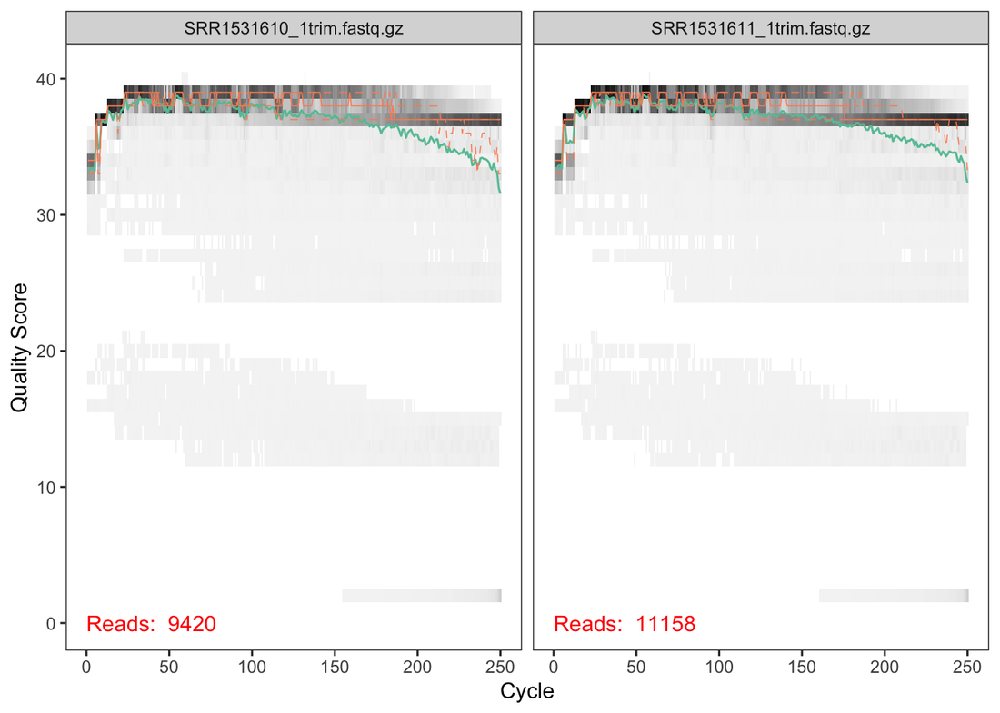
      <figcaption>Quality profiles of the first two forward reads.</figcaption>
    </figure>

    <figure markdown align="center">
      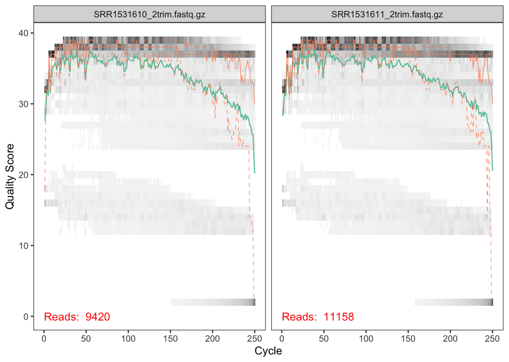
      <figcaption>Quality profiles of the first two reverse reads. The quality drops after position ~230.</figcaption>
    </figure>

!!! tip "Read quality"
    One can see that the QC plot show good quality for Forward reads and a lower quality for Reverse reads after position 230.


#### Filtering and truncation of reads

We filter the reads with the standard parameters: `maxN=0` (DADA2 requires no Ns), `truncQ=2`, `rm.phix=TRUE` and `maxEE=2`. The `maxEE` parameter sets the maximum number of "expected errors" allowed in a read, which is a better filter than simply averaging quality scores. In this case we do not truncate the reads (`truncLen=0`) but in other cases it could be adjusted, e.g. `truncLen=c(220,160)`.

!!! terminal "RStudio"
    ```r title="Filter and trim" linenums="25"
    # Filter and place filtered files in filtered/ subdirectory
    filtFs <- file.path(path, "filtered", paste0(sample.names, "_F_filt.fastq.gz"))
    filtRs <- file.path(path, "filtered", paste0(sample.names, "_R_filt.fastq.gz"))
    names(filtFs) <- sample.names
    names(filtRs) <- sample.names

    out <- filterAndTrim(fnFs, filtFs, fnRs, filtRs, truncLen=0,
                        maxN=0, maxEE=c(2,2), truncQ=2, rm.phix=TRUE,
                        compress=TRUE, multithread=TRUE) # On Windows set multithread=FALSE
    head(out)
    ```

    ```bash title="Console output"
                              reads.in reads.out
    SRR1531610_1trim.fastq.gz     9420      8172
    SRR1531611_1trim.fastq.gz    11158      9781
    SRR1531619_1trim.fastq.gz    11625     10213
    SRR1531622_1trim.fastq.gz    12301     10825
    SRR1531625_1trim.fastq.gz     7650      6639
    SRR1531628_1trim.fastq.gz     9388      8293
    ```

#### Learn the error rates and correct the reads

!!! warning "Slow step"
    This part is relatively slow (about 5 min on a laptop).

DADA2 learns the error rates from the data itself using a machine-learning algorithm, once for the forward and once for the reverse reads:

!!! terminal "RStudio"
    ```r title="Learn the error rates" linenums="36"
    errF <- learnErrors(filtFs, multithread=TRUE)
    errR <- learnErrors(filtRs, multithread=TRUE)

    plotErrors(errF, nominalQ=TRUE)
    plotErrors(errR, nominalQ=TRUE)
    ```
??? success "Estimated errors"
    <figure markdown align="center">
      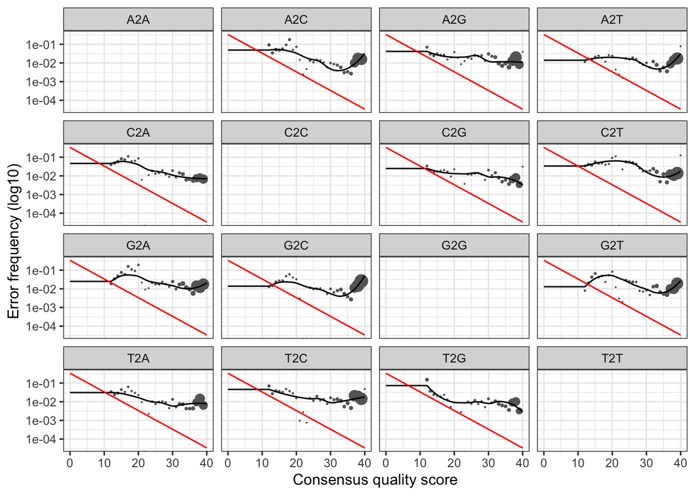
      <figcaption>Estimated error rates for the forward reads. The black line (learned) fits the observed points well.</figcaption>
    </figure>

    <figure markdown align="center">
      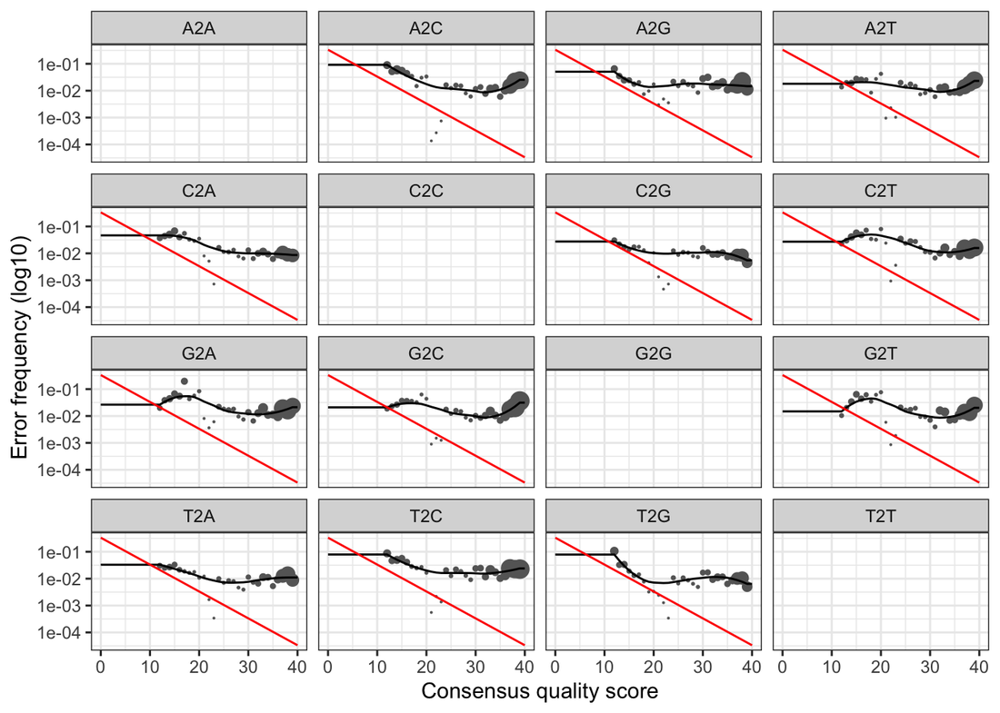
      <figcaption>Estimated error rates for the reverse reads.</figcaption>
    </figure>

!!! tip "Error rates"
    The error rates for each possible transition (A->C, A->G, ...) are shown. Points are the observed error rates for each consensus quality score. The black line shows the estimated error rates after convergence of the machine-learning algorithm. The red line shows the error rates expected under the nominal definition of the Q-score.

Everything looks reasonable, so we can proceed with confidence and apply the core sample-inference algorithm:

!!! terminal "RStudio"
    ```r title="Denoise the reads" linenums="42"
    #We are now ready to apply the core sample DADA2 inference algorithm to the filtered and trimmed sequence data.
    dadaFs <- dada(filtFs, err=errF, multithread=TRUE, pool="pseudo") # On Windows set multithread=FALSE
    dadaRs <- dada(filtRs, err=errR, multithread=TRUE, pool="pseudo")
    dadaFs[[1]]
    ```

    ```bash title="Console output"
    dada-class: object describing DADA2 denoising results
    152 sequence variants were inferred from 4774 input unique sequences.
    Key parameters: OMEGA_A = 1e-40, OMEGA_C = 1e-40, BAND_SIZE = 16
    ```

??? tip "Pooling samples"
    By default, the `dada` function processes each sample independently. Pooling information across samples can increase sensitivity to sequence variants that may be present at very low frequencies in multiple samples. `dada(..., pool=TRUE)` performs standard pooled processing, whereas `dada(..., pool="pseudo")` (used above) shares information between samples while processing them independently, approximating pooled inference in linear time. You'll find an explanation [here](https://benjjneb.github.io/dada2/pseudo.html).

#### Merging the reads

Now we merge the forward and reverse reads into a single amplicon sequence and write a FASTA file with the merged sequences per sample:

!!! terminal "RStudio"
    ```r title="Merge paired reads" linenums="47"
    merged <- mergePairs(dadaFs, filtFs, dadaRs, filtRs, verbose=TRUE)

    # If desired, Inspect the merger data.frame from the first sample. Uncomment the following line
    #head(merged[[1]])

    #write Fasta files of merged sequences
    for(nm in names(merged)) {
      mrg <- merged[[nm]]
      if(nrow(mrg) > 0) {
        uniquesToFasta(mrg, paste0("merged_", nm, ".fasta"))
      }
    }
    ```

#### Construct the sequence table

We build a table of counts for all merged sequences (one column per ASV) and inspect the distribution of sequence lengths:

!!! terminal "RStudio"
    ```r title="Sequence table" linenums="60"
    # We make a table of counts for all sequences merged
    seqtab <- makeSequenceTable(merged)
    #dim(seqtab)

    # Inspect distribution of sequence lengths
    table(nchar(getSequences(seqtab)))
    ```

    ```bash title="Console output"
    312  424  438  441  453  454  455  456  457  458  459  460  461  464  468 
    13    1    2    1    3  993  702   72  613  785 1829    1   12    3    1 
    469  471  472  473  474  475  476  477  478  479  480 
     6   26   36  138 1235   24   23    1  376 1177   38 
    ```    

??? info "Cutting the band"
    You can remove non-target-length sequences from the sequence table, e.g. `seqtab2 <- seqtab[,nchar(colnames(seqtab)) %in% 250:262]`. This is analogous to "cutting a band" in-silico to get amplicons of the targeted length. Here we see multiple peaks (not a good sign), so we can cut around the expected V3–V4 length.

Here we see that we have multiple peaks... not a good sign, anyway we cut around them,

!!! terminal "RStudio"
    ```r title="Keep target-length ASVs" linenums="67"
    seqtab2 <- seqtab[,nchar(colnames(seqtab)) %in% 450:481]
    ```

#### Remove chimeras

Chimeras are PCR artifacts that must be identified and removed. We use the consensus method and check the proportion of reads kept:

!!! terminal "RStudio"
    ```r title="Remove chimeras" linenums="69"
    seqtab2.nochim <- removeBimeraDenovo(seqtab2, method="consensus", multithread=TRUE, verbose=TRUE)

    #If you want to check the number of removed sequences, uncomment these lines
    #dim(seqtab2.nochim)
    #sum(seqtab2.nochim)/sum(seqtab2)

    #We save the final table
    write.table(t(seqtab2.nochim), "seqtab-nochim.txt", sep="\t", row.names=TRUE, col.names=NA, quote=FALSE)
    ```

#### Track reads through the pipeline

It is important to keep track of how many reads survive each step. We build a table that summarises the number of reads at each stage of the pipeline:

!!! terminal "RStudio"
    ```r title="Track read counts" linenums="78"
    getN <- function(x) sum(getUniques(x))
    track <- cbind(out, sapply(dadaFs, getN), sapply(dadaRs, getN), sapply(merged, getN), rowSums(seqtab2.nochim))
    # If processing a single sample, remove the sapply calls: e.g. replace sapply(dadaFs, getN) with getN(dadaFs)

    colnames(track) <- c("input", "filtered", "denoisedF", "denoisedR", "merged", "nonchim")
    rownames(track) <- sample.names
    head(track)
    ```

    ```bash title="Console output"
               input filtered denoisedF denoisedR merged nonchim
    SRR1531610  9420     8172      5805      5919   5167    4465
    SRR1531611 11158     9781      7048      6769   5414    5182
    SRR1531619 11625    10213      9055      8934   7882    5680
    SRR1531622 12301    10825      9026      8751   7710    5891
    SRR1531625  7650     6639      5850      5773   4959    3548
    SRR1531628  9388     8293      6980      6836   5998    5020
    ```     

Looks good! We kept the majority of our raw reads, and there is no over-large drop associated with any single step.

#### Assign taxonomy

!!! warning "Slow step"
    This part is very slow: about 45 min on an old laptop! Once launched, go for a break.

We assign a taxon to each ASV using the reference Silva database v138.1:

!!! terminal "RStudio"
    ```r title="Assign taxonomy" linenums="86"
    #We assign a taxon for each ASV using the Reference Silva database v138
    taxa <- assignTaxonomy(seqtab2.nochim, "~/Desktop/eDNAworkshop2026/silva_nr99_v138.1_wSpecies_train_set.fa.gz", multithread=TRUE)

    taxa.print <- taxa # Removing sequence rownames for display only
    rownames(taxa.print) <- NULL
    head(taxa.print)
    ```

    ```bash title="Console output"
          Kingdom    Phylum              Class                 Order            
    [1,] "Bacteria" "Cyanobacteria"     "Cyanobacteriia"      "Chloroplast"    
    [2,] "Bacteria" "Cyanobacteria"     "Cyanobacteriia"      "Chloroplast"    
    [3,] "Bacteria" "Proteobacteria"    "Gammaproteobacteria" "Burkholderiales"
    [4,] "Bacteria" "Verrucomicrobiota" "Verrucomicrobiae"    NA               
    [5,] "Bacteria" NA                  NA                    NA               
    [6,] "Bacteria" "Proteobacteria"    "Gammaproteobacteria" "Burkholderiales"
        Family           Genus           Species
    [1,] NA               NA              NA     
    [2,] NA               NA              NA     
    [3,] "Comamonadaceae" "Limnohabitans" NA     
    [4,] NA               NA              NA     
    [5,] NA               NA              NA     
    [6,] "Comamonadaceae" "Limnohabitans" NA
    ```

!!! terminal "RStudio"
    ```r title="Assign taxonomy" linenums="93"
    #save taxonomy assignment
    write.table(t(taxa), "seqtab-taxa.txt", sep="\t", row.names=TRUE, col.names=NA, quote=FALSE)
    #get representative sequences in FASTA
    uniquesToFasta(seqtab2.nochim, fout='rep-seqs.fna', ids=colnames(seqtab2.nochim))

    #save RDS files for second part
    saveRDS(seqtab2.nochim, 'seqtab2.nochim.rds')
    saveRDS(taxa, 'taxa.rds')
    ```

This is the end of **Part I**. Move on to **Part II** for the downstream analysis.

## Session 4 - Targeted sequencing II

### Part II - Downstream analysis with PhyloSeq

In this second part we analyse the DADA2 outputs with PhyloSeq and friends: α-diversity, β-diversity, barplots, geographic localisation and a LEfSe analysis. If you skipped Part I, load the pre-computed `seqtab2.nochim.rds` and `taxa.rds` files from the [Material](#material) section.

#### Experimental setting

Open RStudio, and set the downloaded directory as working directoy (i.e. `~/Desktop/eDNAworkshop2026`). We will build a `phyloseq` object that combines the ASV count table, the sample metadata and the taxonomy table. Hence, create a new R file and start writing and executing the code as follows:

!!! terminal "RStudio"
    ```r title="Experimental setting" linenums="1"
    options(conflicts.policy = list(warn = FALSE)) #this line removes all warnings of function masking
    library(phyloseq, quietly = TRUE)
    library(Biostrings, quietly = TRUE)
    library(ggplot2, quietly = TRUE)
    library(magrittr, quietly = TRUE)
    library(vegan, quietly = TRUE)

    theme_set(theme_bw())

    #CHANGE PATH according to your settings
    setwd("~/Desktop/eDNAworkshop2026")
    samdf <- read.delim("PRJNA256993_SraRunTable.txt")
    rownames(samdf)<-samdf$Run
    samdf<-samdf[,-1]

    #convert Collection_Date to a "date"
    samdf$Collection_Date<-as.Date(samdf$Collection_Date, "%d.%m.%Y") %>% format("20%y%m%d") %>% as.Date("%Y%m%d")

    #read RDS data
    seqtab2.nochim <- readRDS("seqtab2.nochim.rds")
    taxa <- readRDS("taxa.rds")

    #build phyloseq obj without tree
    ps <- phyloseq(otu_table(seqtab2.nochim, taxa_are_rows=FALSE),
                  sample_data(samdf),
                  tax_table(taxa))

    #verify the phyloseq object
    ps
    ```

    ```bash title="Console output"
    phyloseq-class experiment-level object
    otu_table()   OTU Table:         [ 4064 taxa and 24 samples ]
    sample_data() Sample Data:       [ 24 samples by 10 sample variables ]
    tax_table()   Taxonomy Table:    [ 4064 taxa by 7 taxonomic ranks ]
    refseq()      DNAStringSet:      [ 4064 reference sequences ]
    ```

#### Rarefaction curves

Plotting the rarefaction curve is a quality check to verify that we reached saturation of the sampling.

!!! terminal "RStudio"
    ```r title="Rarefaction" linenums="31"
    #plotting the rarefaction curve is a quality check to verify that we reached saturation of the sampling
    rarecurve(data.frame(otu_table(ps, taxa_are_rows = 1)), step=100, col="blue", lwd=2, ylab="ASVs", main="Rarefaction Curve for all samples")
    ```

??? success "Rarefaction curves"
    <figure markdown align="center">
      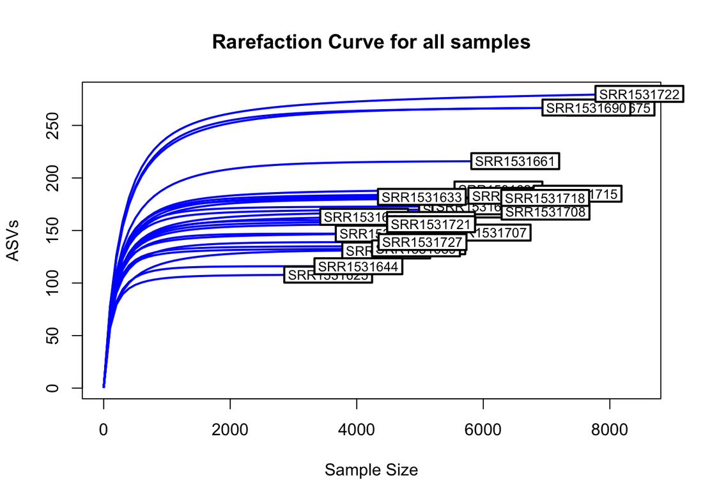
      <figcaption>Rarefaction curves for all samples. When is the saturation reached?</figcaption>
    </figure>

#### Richness plots

We then add the ASV sequences to the object and rename the ASVs, and check the α-diversity with several richness indices, either by Depth or by Fraction, along the river:

!!! terminal "RStudio"
    ```r title="Alpha diversity" linenums="34"
    #extract ASV sequences and add them to the phyloseq object renaming the ASVs
    dna <- Biostrings::DNAStringSet(taxa_names(ps))
    names(dna) <- taxa_names(ps)
    ps <- merge_phyloseq(ps, dna)
    taxa_names(ps) <- paste0("ASV", seq(ntaxa(ps)))

    #Now we check the alpha diversity by plotting different richness indices either by Depth or by Fraction vs the position along the river
    plot_richness(ps, x="pos_km", color="factor(Depth)", measures=c("Shannon", "Simpson", "Chao1"))
    plot_richness(ps, x="pos_km", color="factor(Fraction)", measures=c("Shannon", "Simpson", "Chao1"))
    ```

??? success "Alpha diversity plots"
    <figure markdown align="center">
      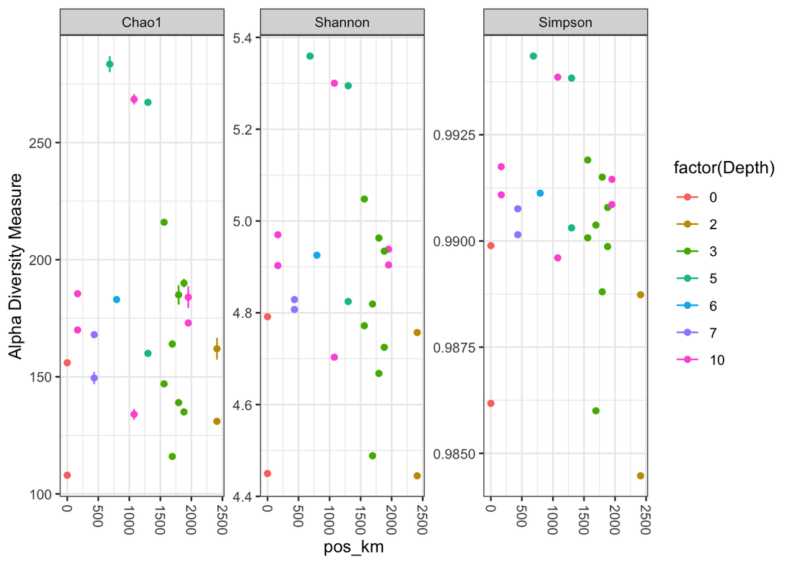
      <figcaption>Alpha diversity indices along the river, coloured by Depth.</figcaption>
    </figure>

    <figure markdown align="center">
      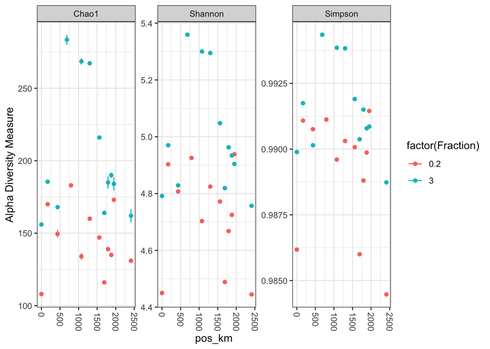
      <figcaption>Alpha diversity indices along the river, coloured by Fraction.</figcaption>
    </figure>

!!! question "Question"
    Can you see an effect?

#### Shannon plot with regression

We now focus on the Shannon diversity, plotting the regression line by Fraction size along the river:

!!! terminal "RStudio"
    ```r title="Shannon diversity with regression" linenums="44"
    #OK we will focus on the Shannon diversity, but plotting the regression line by Fraction size
    ps_alpha_div <- estimate_richness(ps, split = TRUE, measure = "Shannon")
    sample_metadata = data.frame(sample_data(ps))
    ps_alpha_div$Fraction = sample_metadata$Fraction[match(rownames(ps_alpha_div), rownames(sample_metadata))]
    ps_alpha_div$pos_km = sample_metadata$pos_km[match(rownames(ps_alpha_div), rownames(sample_metadata))]

    ps_alpha_small<-ps_alpha_div[ps_alpha_div$Fraction == '0.2',]
    ps_alpha_large<-ps_alpha_div[ps_alpha_div$Fraction > '0.2',]
    visuals = rbind(ps_alpha_small,ps_alpha_large)

    #plot the regressions with confidence intervals
    p3 <- ggplot(visuals, aes(x=pos_km, y=Shannon, group=visuals$Fraction, color=factor(visuals$Fraction))) +
      geom_point() +
      geom_smooth(data=visuals, method=lm , aes(x=pos_km, y=Shannon, group=visuals$Fraction, color=factor(visuals$Fraction)), fill="#99b3a2", se=TRUE, size=1) +
      labs(colour = "Fraction")
    p3
    ```

??? success "Shannon diversity regression"
    <figure markdown align="center">
      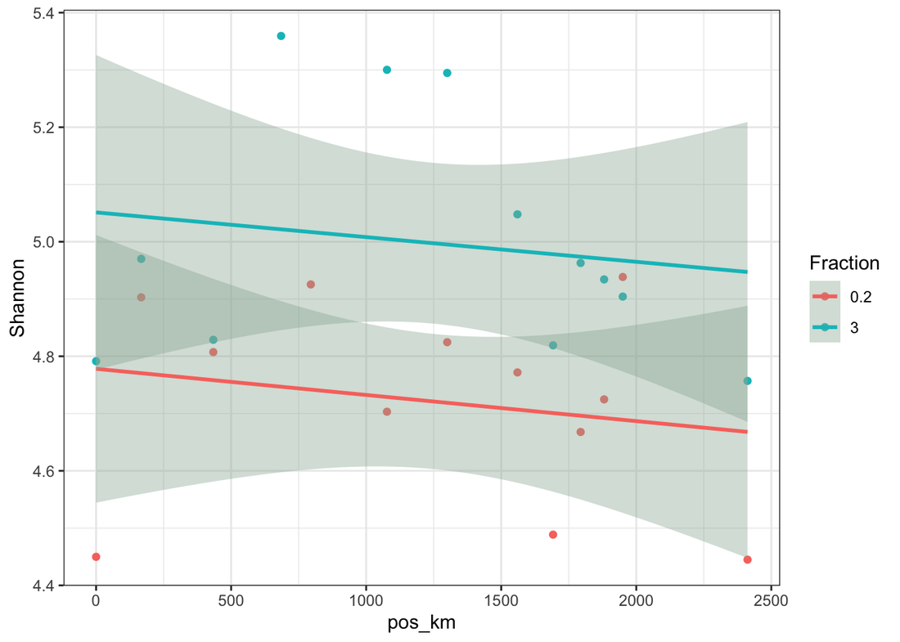
      <figcaption>Shannon diversity along the river with a regression line per Fraction.</figcaption>
    </figure>

!!! question "Question"
    Do you see a clear separation of the Fraction?

#### Beta diversity

We transform the data to proportions (appropriate for Bray-Curtis distances) and ordinate the samples with a non-metric multidimensional scaling (NMDS). 

!!! terminal "RStudio"
    ```r title="Beta diversity" linenums="61"
    #Transform data to proportions as appropriate for Bray-Curtis distances
    ps.prop <- transform_sample_counts(ps, function(otu) otu/(sum(otu)+1))
    ord.nmds.bray <- ordinate(ps.prop, method="NMDS", distance="bray")
    sample_data(ps.prop)$Fraction=as.character(sample_data(ps.prop)$Fraction)
    plot_ordination(ps.prop, ord.nmds.bray, color="Fraction", title="Bray NMDS") + geom_point(size=3)
    ```

??? success "NMDS ordination"
    <figure markdown align="center">
      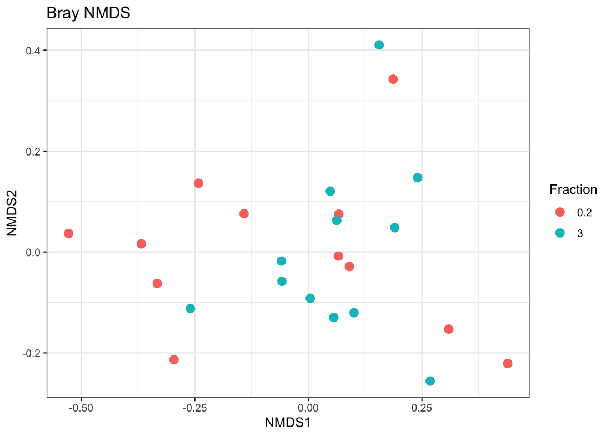
      <figcaption>NMDS ordination of the samples using Bray-Curtis distances.</figcaption>
    </figure>

!!! tip "Not always the separation is clear"
  Data exploration shows no clear separation.

#### Abundance plots

We also plot the genus and phylum abundance per sample:

!!! terminal "RStudio"
    ```r title="Barplot top 20" linenums="67"
    #Now we try to plot the Genus abundance by sample keeping only the first 20 most abundant taxa.
    top20 <- names(sort(taxa_sums(ps), decreasing=TRUE))[1:20]
    ps.top20 <- transform_sample_counts(ps, function(OTU) OTU/(sum(OTU)+1))
    ps.top20 <- prune_taxa(top20, ps.top20)
    plot_bar(ps.top20, x="BioSample", fill="Genus") + geom_bar(aes(color=Genus, fill=Genus), stat="identity", position="stack")
    ```

??? success "Barplot top 20"
    <figure markdown align="center">
      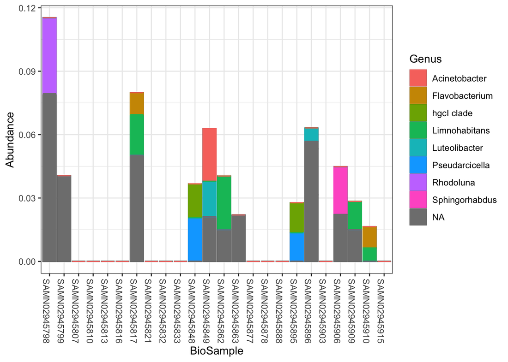
      <figcaption>Genus abundance per sample (top 20 most abundant taxa).</figcaption>
    </figure>

!!! terminal "RStudio"
    ```r title="Barplot top 1000" linenums="71"
    #plot Phylum abundance of first 1000 most abundant taxa
    top1000 <- names(sort(taxa_sums(ps), decreasing=TRUE))[1:1000]
    ps.top1000 <- transform_sample_counts(ps, function(OTU) OTU/(sum(OTU)+1))
    ps.top1000 <- prune_taxa(top1000, ps.top1000)
    plot_bar(ps.top1000, x="BioSample", fill="Phylum") + geom_bar(aes(color=Phylum, fill=Phylum), stat="identity", position="stack")
    ```

??? success "Barplot top 1000"
    <figure markdown align="center">
      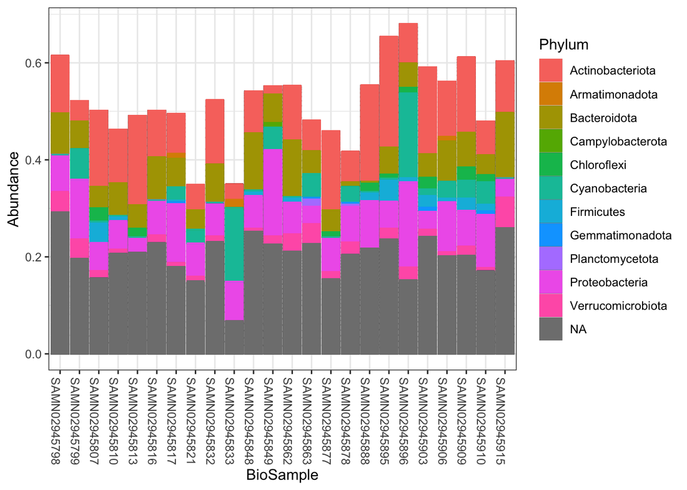
      <figcaption>Phylum abundance per sample (top 1000 most abundant taxa).</figcaption>
    </figure>

!!! info "Interpretation"
    Many samples do not contain one of the 20 most abundant genera! However, some taxa are typical of fresh water (Acinetobacter, Flavobacter, Rhodoluna, Limnohabitans, Pseudarcicella, Sphingorhabdus) or sludge (Luteolibacter).

!!! question "Question"
    Are there differences?

#### Phylogeo localization

What about the geographic localization of the samples? We use the [`leaflet`](https://rstudio.github.io/leaflet/) package to map the sample coordinates to geographic maps:

!!! warning "Extra packages"
    This part of the analysis requires the installation of additional packages.

!!! terminal "RStudio"
    ```r title="Phylogeo localization" linenums="77"
    install.packages("leaflet")
    install.packages("tidyverse")
    library(tidyverse)
    library(leaflet)

    map_data <- data.frame(sample_data(ps))
    color_variable <- map_data$geo_loc_name_country
    pal <- colorFactor(palette = "Set1", domain = color_variable)

    leaflet(data = map_data) %>%
      addTiles() %>%  # Adds default OpenStreetMap map tiles
      addCircleMarkers(
        lng = ~Longitude,
        lat = ~Latitude,
        popup = ~geo_loc_name_country,  # Text that appears when clicking a point
        radius = 6,
        color = ~pal(geo_loc_name_country),
        stroke = FALSE, 
        fillOpacity = 0.8
      )
    ```
??? success "Phylogeo localization"
    <figure markdown align="center">
      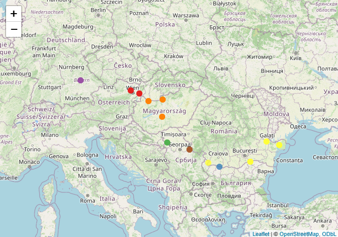
      <figcaption>Sample localization within each country.</figcaption>
    </figure>

!!! info "Interactive map"
    The interactive map will be reachable on the `viewer` tab in the output pane.

#### LEfSe analysis

Can we identify taxa that are specific for the two fractions (0.2 µm vs. 3 µm)? We use LEfSe (**L**inear discriminant analysis **Ef**fect **S**iz**e**) on the genus table with the `microbiomeMarker` package:

!!! terminal "RStudio"
    ```r title="LEfSe analysis" linenums="98"
    #We use LEfSe to assess possible differences
    #remotes::install_github("yiluheihei/microbiomeMarker")
    library(microbiomeMarker, quietly = TRUE)

    sample_data(ps)$Fraction=as.character(sample_data(ps)$Fraction)
    lef_out<-microbiomeMarker::run_lefse(ps, group="Fraction", taxa_rank="Genus")
    microbiomeMarker::plot_ef_bar(lef_out)
    ```

??? success "LEfSe"
    <figure markdown align="center">
      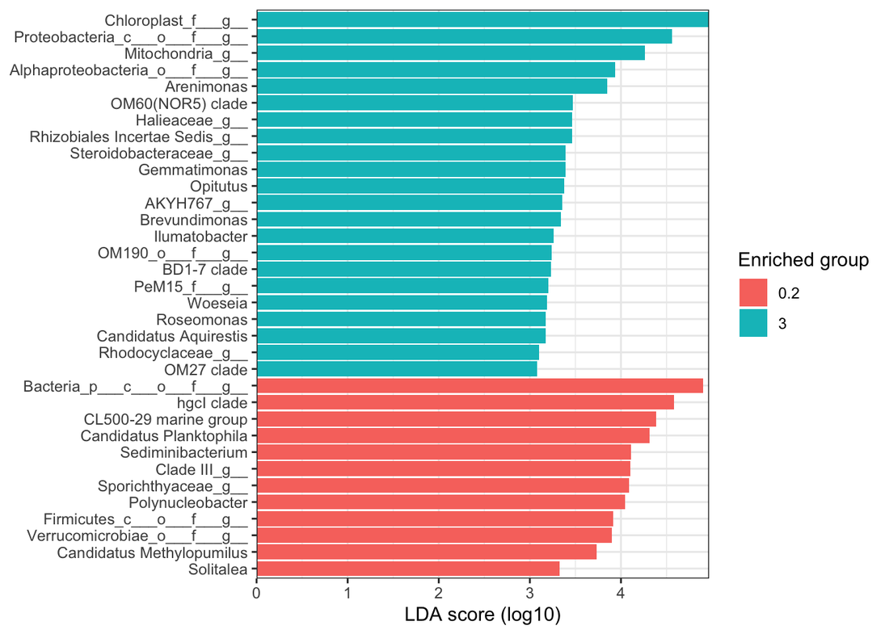
      <figcaption>LEfSe results: genera with a significant Linear Discriminant Analysis (LDA) effect size between the two fractions.</figcaption>
    </figure>

Some taxa are known from lakes, rivers or seas (CL500-29 marine group, _Halioglobus_, _Polynucleobacter_) or from sediment/water interfaces (_Gemmatimonas_, _Opitutus_, _Brevundimonas_, _Ilumatobacter_, _Sediminibacterium_, _Solitalea_), and even some potential pathogens (_Roseomonas_). The hgcl-clade group is typical of areas associated with urban and industrial activities.

## Summary

Several tools were introduced to analyse 16S amplicon sequences from different samples along 2,600 km of the Danube river. The first part related to processing of the read data: QC, cleaning, filtering, error correction, merging, and taxonomy assignment. The second part related to α-diversity, β-diversity, various plots, geographic localisation, and linear discriminant analysis to highlight some interesting differences and taxa.

## Additional resources

If you want to explore more in detail how you can expand your analysis, please check the following resources:

* [DADA2 tutorial](https://benjjneb.github.io/dada2/tutorial.html)
* [DADA2 pseudo-pooling](https://benjjneb.github.io/dada2/pseudo.html)
* [Silva v138 DADA2 training data](https://zenodo.org/records/4587955)
* [Savio et al. (2015) - bacterial diversity along the Danube river](https://ami-journals.onlinelibrary.wiley.com/doi/10.1111/1462-2920.12886)
* [phylogeo](http://zachcp.github.io/phylogeo/)
* [microbiomeMarker](https://github.com/yiluheihei/microbiomeMarker)
* [Phyloseq tutorial](https://vaulot.github.io/tutorials/Phyloseq_tutorial.html)