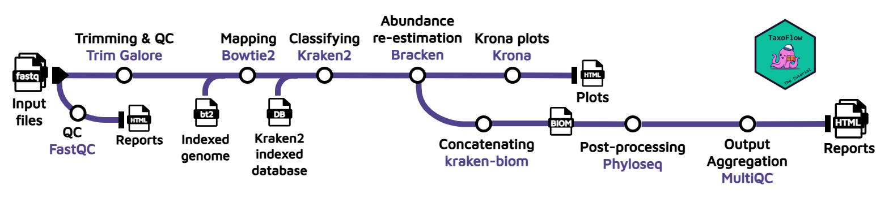

# Day 3 - Shotgun metagenomics: classification and downstream analysis

## Learning outcomes

**After having completed this chapter you will be able to:**

* Explain the principles of shotgun (whole-genome) metagenomics and how library preparation, sequencing depth and coverage shape the analysis.
* Distinguish k-mer-based from alignment-based approaches for read-level taxonomic classification.
* Distinguish taxonomic **classification** (per-read assignment) from taxonomic **profiling** (community composition estimates).
* Run a reference-based metagenomics pipeline (Bowtie2 → Kraken2 → Bracken → Krona) with Nextflow.
* Explore taxonomic profiles per sample with interactive Krona plots.
* Compare samples with Pavian using Kraken2 reports.
* Build a Phyloseq object from a BIOM file and sample metadata.
* Estimate α- and β-diversity, and run ordination and network analyses.

## Whole genome sequencing and taxonomic classification

### Principles of shotgun metagenomic sequencing

Unlike targeted amplicon sequencing ([Day 2](day2_targeted_amplification_analysis.md)), shotgun metagenomics sequences **all the DNA present in a sample at once**. The community DNA is fragmented (physically or enzymatically), sequencing adapters are ligated to both ends of every fragment, and the library is sequenced from both sides. No prior knowledge of which organisms are present is required, so the approach captures bacteria, archaea, fungi, viruses and host DNA. Crucially, it delivers **functional information** (genes, pathways, MAGs) in addition to taxonomy.

### Library preparation, depth and coverage

Several design decisions determine what a shotgun dataset can resolve:

* **Library preparation**: typically PCR-free or low-cycle protocols are preferred to avoid amplification bias; paired-end short reads (2×150 bp) are the standard, while long-read libraries (PacBio, Nanopore) improve continuity at higher cost and error rate. Host DNA depletion or methylation-based enrichment can be used when the microbial fraction is low (e.g. clinical samples).
* **Sequencing depth**: how many reads are generated per sample. Shallow shotgun (~1 Gb) supports family-level profiling; deep sequencing (5–20+ Gb) is needed for strain resolution, assembly and MAG recovery.
* **Coverage**: the number of times a genome is sequenced, which depends on sequencing depth and on the relative abundance of the organism in the community. A genome at 1% relative abundance in a 10 Gb run receives only ~100 Mb of reads (often not enough to assemble). **Abundance and genome size therefore jointly determine which members of a community can be recovered as MAGs.**
* **Community complexity**: diverse environments (soil, marine) dilute the coverage of individual genomes, while low-complexity communities (gut, enrichment cultures) are more amenable to assembly and binning ([Day 4](day4_assembly_and_binning.md)).

### Read-based taxonomic classification

Before dealing with assemblies (Days 4–5), the fastest way to obtain a community profile is to classify individual reads against a reference database. Two families of methods dominate:

* **k-mer (hashing)-based**: each read is split into k-mers, and the taxonomy of the k-mers (precomputed from a reference genome database) votes for the most likely origin of the read. Extremely fast and memory-efficient for large databases. _Examples: **Kraken2**, KrakenUniq, Centrifuge._
* **alignment-based**: reads (or their translated products) are aligned with BLAST or DIAMOND against reference sequences; taxonomies are then transferred from the best hits. Slower, but sensitive for divergent sequences and protein-level (functional) assignment. _Examples: DIAMOND+MEGAN, BLAST-based classifiers._
* **marker-gene-based**: only reads matching clade-specific marker genes are used (e.g. MetaPhlAn). Compact, but limited to the markers represented in the database.

!!! warning "The database is the analysis"
    All reference-based methods are only as good as their database: incomplete or mislabelled references produce false positives and missing taxa. Always record which database version you used.

## Session 5 - Taxonomic classification

### Objective

Execute an end-to-end workflow with the aim of performing taxonomic classification and abundance estimation, as well as analyze preliminary results.

### About the data

The data set we will be using for this part of the workshop was collected in Cuatro Ciénegas (México), _an oasis in the Mexican desert whose environmental conditions are often linked to the ones present in ancient seas, due to a higher-than-average content of sulfur and magnesium but a lower concentrations of phosphorus and other nutrients_. For more information about this study, please check [Okie et al., (2020)](https://elifesciences.org/articles/49816); the BioProject accession number is [PRJEB22811](https://www.ncbi.nlm.nih.gov/bioproject/PRJEB22811).

The experiment metadata used throughout this chapter:

| Name | Group | Replicate |
|------|-------|-----------|
| ERR2143758 | Cont | 1 |
| ERR2143759 | Cont | 2 |
| ERR2143760 | Cont | 3 |
| ERR2143771 | Unenriched | 1 |
| ERR2143772 | Unenriched | 2 |
| ERR2143774 | Unenriched | 3 |
| ERR2143769 | Fertilized | 1 |
| ERR2143770 | Fertilized | 2 |
| ERR2143773 | Fertilized | 3 |

### The pipeline

For this course, we propose to wrap with Nextflow the protocol published by [Jennifer Lu et al. (2022)](https://www.nature.com/articles/s41596-022-00738-y). The wrapped workflow is called [TaxoFlow](https://gigabytejournal.com/articles/187) and is designed as follows:

<figure markdown align="center">
  
  <figcaption>Reference-based metagenomics workflow used throughout this session.</figcaption>
</figure>

As you can see from the picture, the input is FASTQ files from one or multiple samples, then it performs a host removal with Bowtie2 by aligning the reads against an indexed reference genome to carry out the taxonomic classification with Kraken2 afterwards. Taking the output from Kraken2, a Bayesian species abundance re-estimation is achieved with Bracken, and Krona plots are generated using the Bracken output to visualize interactively the relative abundance of each annotated species. If multiple samples are used as input to the pipeline, the bracken reports will be concatenated and converted into a Biological Observation Matrix (BIOM) file. Finally, the BIOM file will be first converted in a Phyloseq object, and this object will be further processed to generate absolute plots, estimate both α and β-diversity and perform a network analysis; this information will be presented in a final report.html.

### Running the pipeline

!!! warning "This is only a mock execution/dry run"
    The run performed during the course uses a mock data given the computational constraints in Codespaces. For a proper analysis you can download the proper resources [here](https://benlangmead.github.io/aws-indexes/).

Copy and paste the following commands in the Codespaces terminal:

!!! terminal "CodeSpaces"
    ```bash title="Download Kraken DB"
    cd workshop/TaxoFlow
    mkdir -p data/krakendb && cd "$_"
    wget --no-check-certificate --no-proxy 'https://zenodo.org/api/records/17708950/files/krakendb.tar.gz/content'
    tar -xvzf content
    rm -r content
    cd -
    ```

!!! terminal "CodeSpaces"
    ```bash title="Download indexed genome"
    mkdir -p data/TAIR10 && cd "$_"
    wget --no-check-certificate --no-proxy 'https://genome-idx.s3.amazonaws.com/bt/TAIR10.zip'
    unzip TAIR10.zip
    rm -r TAIR10.zip
    cd -
    ```

The directoy of the pipeline will contain:

??? abstract "Directory content"
    ```bash title="Directory content"
    .
    ├── bin
    │   └── report.Rmd
    ├── data
    │   ├── krakendb
    │   │   ├── database250mers.kmer_distrib
    │   │   ├── database250mers.kraken
    │   │   ├── database.kraken
    │   │   ├── hash.k2d
    │   │   ├── names.dmp
    │   │   ├── nodes.dmp
    │   │   ├── opts.k2d
    │   │   ├── seqid2taxid.map
    │   │   └── taxo.k2d
    │   ├── samples
    │   │   ├── ERR2143768
    │   │   │   ├── ERR2143768_1.fastq.gz
    │   │   │   └── ERR2143768_2.fastq.gz
    │   │   ├── ERR2143770
    │   │   │   ├── ERR2143770_1.fastq.gz
    │   │   │   └── ERR2143770_2.fastq.gz
    │   │   └── ERR2143774
    │   │       ├── ERR2143774_1.fastq.gz
    │   │       └── ERR2143774_2.fastq.gz
    │   ├── samplesheet.csv
    │   └── TAIR10
    │       ├── TAIR10.1.bt2
    │       ├── TAIR10.2.bt2
    │       ├── TAIR10.3.bt2
    │       ├── TAIR10.4.bt2
    │       ├── TAIR10.dict
    │       ├── TAIR10.manifest.json
    │       ├── TAIR10.rev.1.bt2
    │       └── TAIR10.rev.2.bt2
    ├── main.nf
    ├── modules
    │   ├── bowtie2.nf
    │   ├── bracken.nf
    │   ├── fastqc.nf
    │   ├── knit_phyloseq
    │   │   ├── environment.yml
    │   │   └── knit_phyloseq.nf
    │   ├── kraken2.nf
    │   ├── kraken_biom.nf
    │   ├── kReport2Krona.nf
    │   ├── ktImportText.nf
    │   ├── multiqc.nf
    │   └── trimgalore.nf
    ├── nextflow.config
    └── taxoflow.nf
    ```

We are ready to run the pipeline with the command:

!!! terminal "CodeSpaces"
    ```bash title="Execute pipeline"
    nextflow run main.nf --sheet_csv 'data/samplesheet.csv' -profile docker
    ```

??? warning "Mock execution"
    As mentioned before, this was a mock execution, and therefore to perform a real analysis, we have used a proper Kraken2 database for you to analyze the results below. Moreover, for your analysis you need to define the database and indexed genome you want to implement.

??? info "more about TaxoFlow"
    TaxoFlow is both a tutorial and a pipeline. You can learn more about [here](https://taxoflow.work/).

### Pipeline's output

#### Krona plots

One of the main and most useful outputs of Taxoflow is Krona plots. These are interactive, multi-layered pie charts used to visualize hierarchic data derived from taxonomic annotation of the sequences.

You can check all of them here:

<div class="kronaWidget">
<select id="kronaSelect">
  <option value="krona1">ERR2143758</option>
  <option value="krona2">ERR2143759</option>
  <option value="krona3">ERR2143760</option>
  <option value="krona4">ERR2143771</option>
  <option value="krona5">ERR2143772</option>
  <option value="krona6">ERR2143774</option>
  <option value="krona7">ERR2143769</option>
  <option value="krona8">ERR2143770</option>
  <option value="krona9">ERR2143773</option>
</select>

<iframe id="krona1" class="kronaFrame" src="../../assets/krona/ERR2143758.krona.html" width="100%" height="600px"></iframe>
<iframe id="krona2" class="kronaFrame" src="../../assets/krona/ERR2143759.krona.html" width="100%" height="600px" style="display:none;"></iframe>
<iframe id="krona3" class="kronaFrame" src="../../assets/krona/ERR2143760.krona.html" width="100%" height="600px" style="display:none;"></iframe>
<iframe id="krona4" class="kronaFrame" src="../../assets/krona/ERR2143771.krona.html" width="100%" height="600px" style="display:none;"></iframe>
<iframe id="krona5" class="kronaFrame" src="../../assets/krona/ERR2143772.krona.html" width="100%" height="600px" style="display:none;"></iframe>
<iframe id="krona6" class="kronaFrame" src="../../assets/krona/ERR2143774.krona.html" width="100%" height="600px" style="display:none;"></iframe>
<iframe id="krona7" class="kronaFrame" src="../../assets/krona/ERR2143769.krona.html" width="100%" height="600px" style="display:none;"></iframe>
<iframe id="krona8" class="kronaFrame" src="../../assets/krona/ERR2143770.krona.html" width="100%" height="600px" style="display:none;"></iframe>
<iframe id="krona9" class="kronaFrame" src="../../assets/krona/ERR2143773.krona.html" width="100%" height="600px" style="display:none;"></iframe>
</div>

<script>
document.getElementById("kronaSelect").addEventListener("change", function () {
  const value = this.value;
  document.querySelectorAll(".kronaFrame").forEach(iframe => {
    iframe.style.display = "none";
  });
  document.getElementById(value).style.display = "block";
});
</script>

### Pavian

Another way to explore the species abundance across samples, and more importantly compare them, is to use [Pavian](https://fbreitwieser.shinyapps.io/pavian/). Pavian is an interactive, web-based application designed to analyze, explore, and visualize metagenomic classification results, particularly from tools like Kraken2, Centrifuge, and MetaPhlAn.

To use this web server you will need just to upload the Kraken2 reports (`.k2report`) found at `intermediate/kreports/` (download and extract the folder `intermediate.tar.gz` from the **Moodle page**).

!!! tip "Pavian in trouble?"
    In case the Pavian web server is not working properly, we have prepared the report for you, you can find it at `intermediate/Pavian`.

### Questions

Now, perform a visual inspection of the results, and consider the following questions:

!!! question "Question"
    Do you see anything unusual on it? What would be the reasons causing this problem? What do you propose to solve it?

!!! question "Question"
    What do you think of the percentages considering the type of samples we are analyzing?

!!! question "Question"
    Do you observe any difference among samples/replicates, at what taxonomic level?

## Session 6 - Downstream analysis

### Objective

Carry out a downstream analysis using the Kraken2/Bracken output to report important insights in terms of differences among samples.

### Phyloseq object

Now, let's create the Phyloseq object using the BIOM file generated by the pipeline and the experiment metadata. We are going to manipulate a bit the object to add the names of the taxonomic ranks, complete the species names and subset it to have only two conditions.

```r title="Build the Phyloseq object" linenums="1"
library(phyloseq)
library(ggplot2)
library(tidyr)

# change the PATH according to your settings
data_biom <- import_biom("../assets/data/merged.biom")
data_biom@tax_table@.Data <- substring(data_biom@tax_table@.Data, 4)
colnames(data_biom@tax_table@.Data) <- c("Kingdom", "Phylum", "Class", "Order", "Family", "Genus", "Species")

tax_table_df <- as.data.frame(tax_table(data_biom))

# Modify the species column to include genus
tax_table_df$Species <- paste(tax_table_df$Genus, tax_table_df$Species, sep = " ")

# Update the taxonomy table in the phyloseq object
tax_table(data_biom) <- as.matrix(tax_table_df)

# Phyloseq object with only Bacteria
data_biom_bact <- subset_taxa(data_biom, Kingdom == "Bacteria")

samples_df <- tab_sam %>%
  tibble::column_to_rownames("Name")
samples = sample_data(samples_df)
otu_inf = data_biom_bact@otu_table
phy_inf = data_biom_bact@tax_table
merged <- phyloseq(otu_inf, phy_inf, samples)

two_sample_data <- subset_samples(merged, Group == "Cont" | Group == "Unenriched")
two_sample_data
```

??? tip "Where do the input files come from?"
    - `merged.biom` is the Biological Observation Matrix produced by the pipeline from the Bracken reports ([download](../assets/data/merged.biom)).
    - `tab_sam` is the experiment metadata read from `test_sheet.csv` ([download](../assets/data/test_sheet.csv)).

We already have created our Phyloseq object, and we are ready to move on with the analysis.

### α-Diversity

Next, let's explore the α-diversity among samples using two indexes, Chao1 and Shannon:

```r title="α-Diversity (Chao1 & Shannon)" linenums="1"
p = plot_richness(two_sample_data, measures=c("Chao1", "Shannon"), color = "Group")+
    theme_bw()+
    theme(axis.text.x = element_text(angle = 45, vjust = 1,
                                   size = 12, hjust = 1),
        axis.text.y = element_text(size = 14),
        axis.title = element_text(size = 14),
        panel.grid.major = element_blank(),
        panel.grid.minor = element_blank(),
        panel.border = element_blank(),
        strip.text.x = element_text(size = 14),
        legend.text = element_text(size = 10),
        legend.title = element_text(size = 14),
        axis.line = element_line(colour = "black"),
        )+
  labs(x = "Samples",
       color = "Group")

p + geom_point(size=5, alpha=0.7)
```

### β-Diversity

_β-Diversity measures how different two or more communities are, either in their composition (richness) or in the abundance of the organisms that compose it (abundance)_. To perform the analysis, we need to use dimensionality reduction techniques which enable comparisons in a space closer to our understanding (up to 3 dimensions). First, let's create a heatmap that includes an ordination-based ordering of samples or taxa with a Bray-Curtis dissimilarity matrix as input for the ordination method (PCoA):

#### Heatmap

!!! warning "For visualization purposes"
    We filter the "OTU" table using a pre-specified criterion, and we are using _agglomerated_ data.

```r title="Heatmap (Bray-Curtis distance, PCoA ordering)" linenums="1"
phylum_data = tax_glom(two_sample_data, "Phylum")
threshold <- 500
phylum_data_filt <- filter_taxa(phylum_data, function(x) sum(x) > threshold, prune = TRUE)

phyloseq::plot_heatmap(phylum_data_filt, method = "PCoA", distance = "bray",
             taxa.label = "Phylum",
             trans=NULL, low="beige", high="red", na.value="beige") +    theme_bw()+
    theme(axis.text.x = element_text(angle = 45, vjust = 1,
                                   size = 12, hjust = 1),
        axis.text.y = element_text(size = 14),
        axis.title = element_text(size = 14),
        panel.grid.major = element_blank(),
        panel.grid.minor = element_blank(),
        strip.text.x = element_text(size = 14),
        legend.text = element_text(size = 10),
        legend.title = element_text(size = 14))
```

#### Ordination plots

##### Principal Coordinate Analysis (PCoA)

Ordination plots are obtained after dimensionality reduction. As before, we are using a Bray-Curtis dissimilarity matrix as input for a PCoA to establish data structures that guide us towards the identification of differences among samples.

```r title="PCoA ordination plot" linenums="1"
data.ord <- ordinate(two_sample_data, "PCoA", "bray")
plot_ordination(two_sample_data, data.ord, type="samples", color="Group",
                title="Principal Coordinate Analysis")+
    theme(axis.text = element_text(size = 14), axis.title = element_text(size = 14),
        legend.text = element_text(size = 14), strip.text.x = element_text(size = 14),
        plot.title = element_text(size = 16),
        legend.title = element_text(size=16),
        panel.border = element_blank(),
        panel.grid.major = element_blank(),
        panel.grid.minor = element_blank(),
        axis.line = element_line(colour = "black"),
        panel.background = element_blank())+
  geom_point(size=5, alpha=0.7)
```

### Network analysis

Now, leveraging the Phyloseq object and its native functionalities, we can perform a simple network analysis (using Bray-Curtis matrix as input):

```r title="Network analysis" linenums="1"
set.seed(42)
plot_net(phylum_data, distance = "bray", type = "taxa",
         maxdist = 0.9, color="Phylum")+
  guides(color = guide_legend(ncol = 3))
```

### Exercises

Now it's your turn to carry on with the analysis. For instance, you can subset the Phyloseq object to compare the fertilized ponds against the control, then:

!!! question "α-Diversity"
    Do you observe any difference between samples in terms of α-diversity? Try other indexes.

??? tip "Hint"
    ```r title="R code" linenums="1"
    measures <- c("Observed", "Chao1", "ACE", "Shannon", "Simpson", "InvSimpson", "Fisher")
    ```

!!! question "β-Diversity"
    Are the samples organized as expected along the gradients (coordinates)? Does the PCoA capture well the differences among samples? Try different distance methods to compare the results.

??? tip "Hint"
    ```r title="R code" linenums="1"
    dist_methods <- unlist(distanceMethodList)
    ```

!!! question "Normalization/transformation methods"
    As you may have noticed, we did not apply any normalization/transformation method to the data. Let's try a centered-log ratio transformation.

For the centered-log ratio transformation, this is how it is achieved:

```r title="Centered-log ratio transformation" linenums="1"
BiocManager::install("microbiome")
library(microbiome)
data_biom_clr <- microbiome::transform(phylum_data_filt, "clr")
```

Now, re-create the heatmap and the PCoA plots with the transformed data and using Euclidean as distance method. Evaluate if there are differences.

#### Optional

!!! question "Different taxonomic ranks"
    We have performed the analysis at **phylum** level, try changing the taxonomic rank and try to track if the differentially abundant taxa belong to the same phyla identified with the preliminary analysis. Be prepared for really messy plots!

#### Bonus

!!! question "Empty fields"
    Run the following code line and observe the results. There are species that do not count with genus, order or up-tree level information. How is this possible? How do you propose to handle this? What are the implications of this situation?

```r title="Inspect empty taxonomy fields" linenums="1"
summary(data_biom@tax_table@.Data== "")
```

## Additional resources

If you want to explore more in detail how you can expand your analysis, please check the following resources:

* [Phyloseq tutorial](https://vaulot.github.io/tutorials/Phyloseq_tutorial.html)
* [Data Processing and Visualization for Metagenomics](https://carpentries-lab.github.io/metagenomics-analysis/)
* [Integrated analysis with microViz](https://david-barnett.github.io/microViz/)
* [ANCOM-BC2 tutorial](https://www.bioconductor.org/packages/release/bioc/vignettes/ANCOMBC/inst/doc/ANCOMBC2.html)