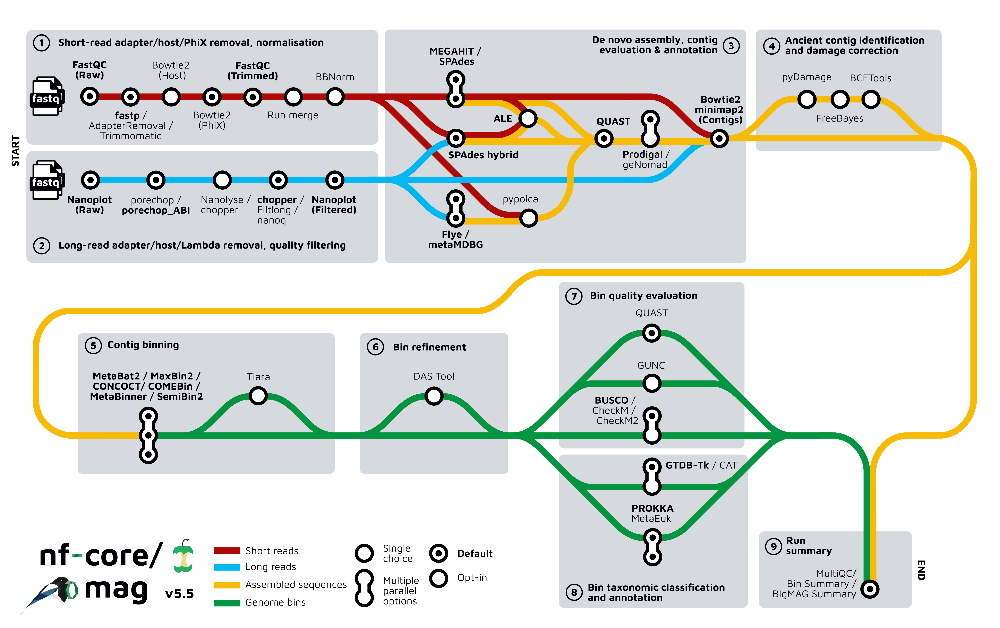
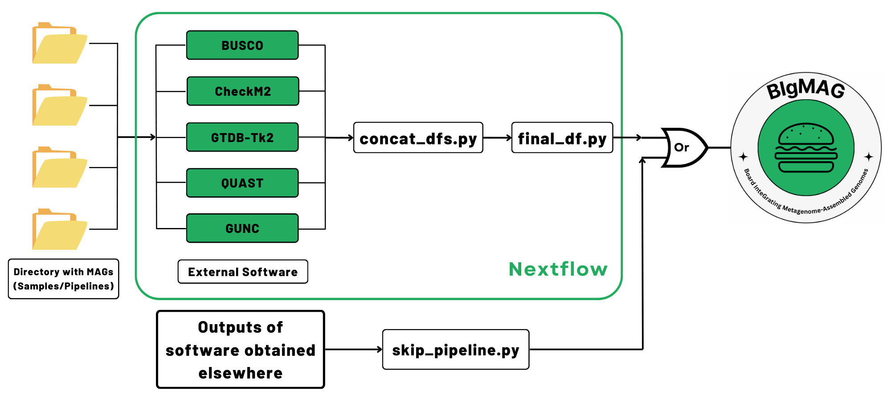
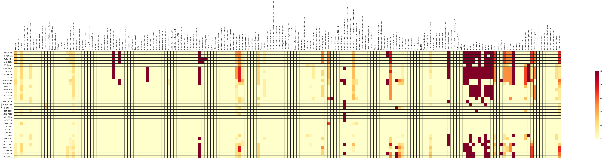
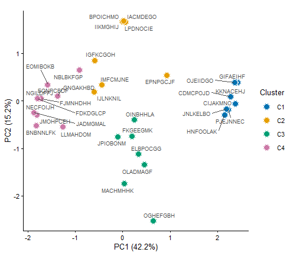
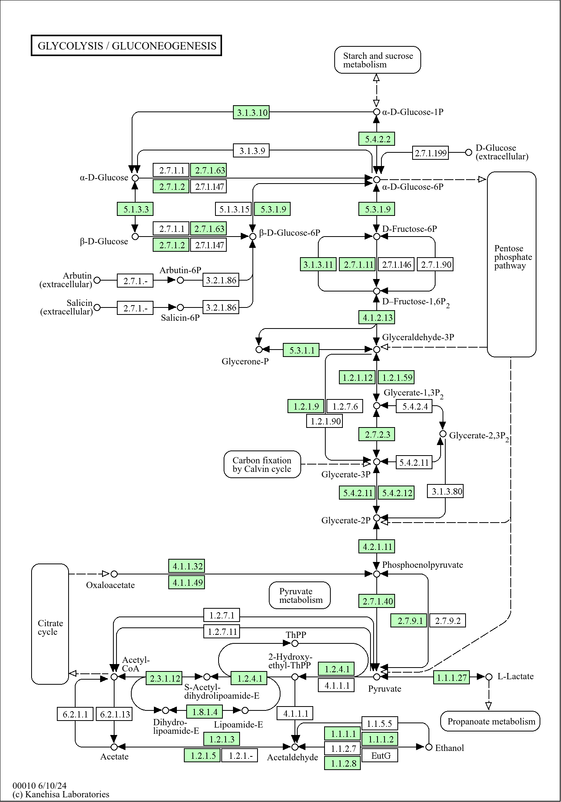
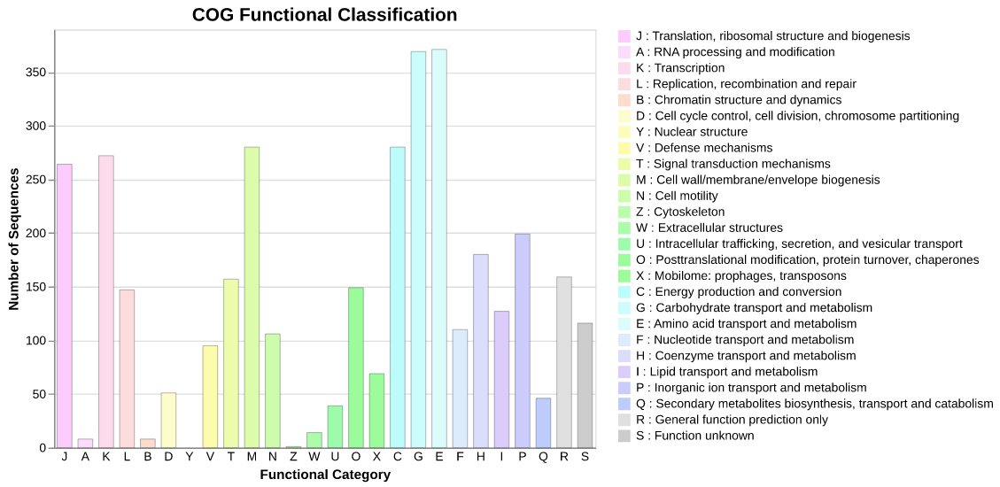
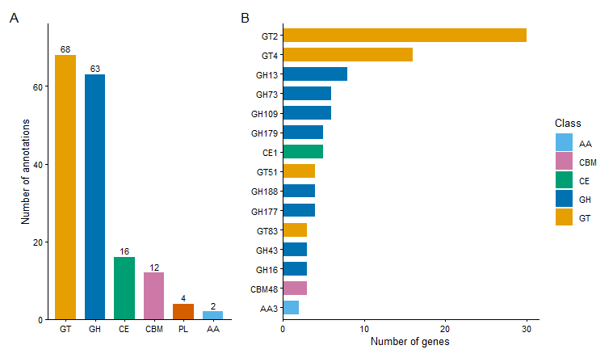
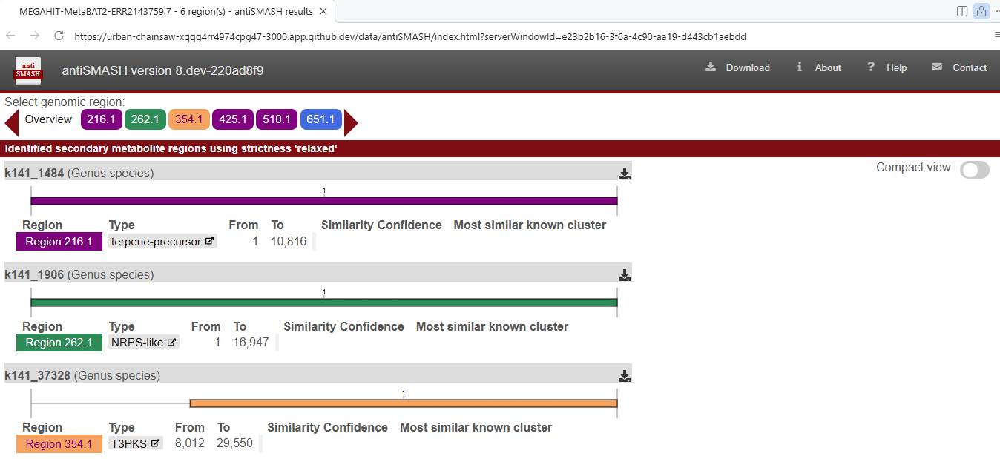
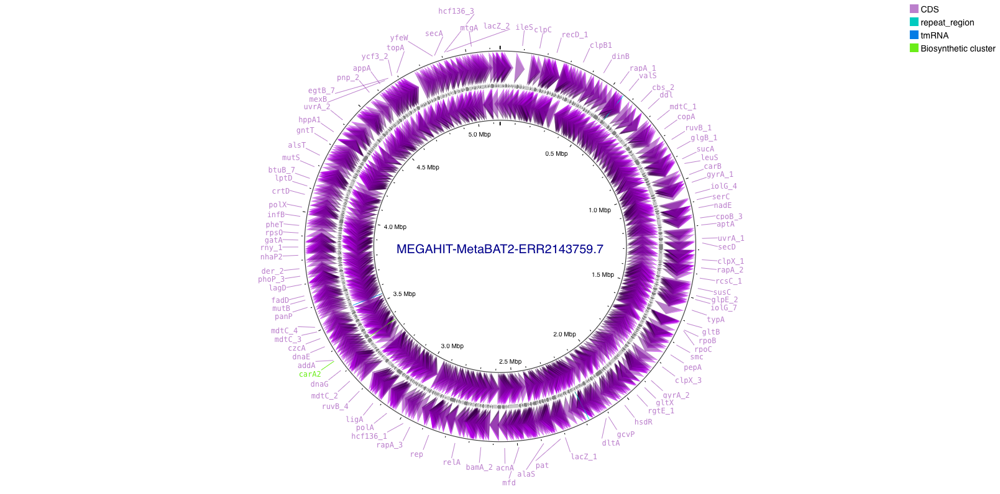
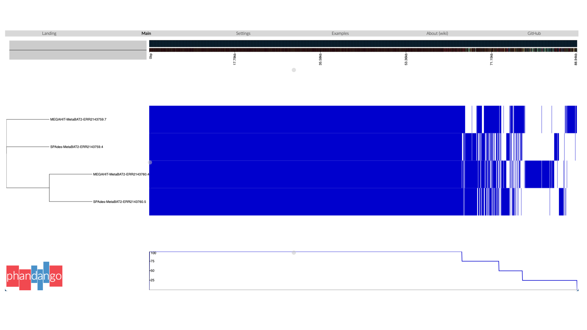

# Day 4 - Pipeline selection, MAG quality assessment and annotation

## Learning outcomes

**After having completed this chapter you will be able to:**

* Explain the principles of _de novo_ metagenomic assembly and the algorithms (de Bruijn graphs) behind the common metagenome assemblers.
* Discuss the challenges that community complexity, strain microdiversity and uneven coverage pose for assembly, and how they translate into fragmented or chimeric contigs.
* Evaluate assembly quality with the standard metrics and tools (contig count, N50, MetaQUAST).
* Describe binning strategies for recovering individual genomes from assemblies, and distinguish composition-based from coverage-based (and hybrid) approaches.
* Evaluate the completeness and contamination of MAGs with BUSCO and CheckM2, and relate the results to quality standards (e.g. MIMAG) for reporting draft genomes.
* Infer the metabolic potential of MAGs from KEGG orthology terms with KEGG Decoder.
* Annotate and compare functional categories with COGclassifier, dbCAN3 (CAZymes) and antiSMASH (biosynthetic gene clusters).
* Visualize and annotate prokaryotic genomes with Proksee, and compare the gene repertoire of related MAGs with a pangenome analysis (Roary/Phandango).

## Material

* **Session 1:** [:fontawesome-solid-file-pdf: Session 1 slides](../assets/pdf/Intro%20MDA-Day4-Part1.pdf){: .md-button }
* **Session 2:** [:fontawesome-solid-file-pdf: Session 2 slides](../assets/pdf/Intro%20MDA-Day4-Part2.pdf){: .md-button }

## Principles of _de novo_ assembly

Assembly reconstructs the original genomes from millions of short (or long) reads, without a reference. In its simplest form the problem is solved by finding overlaps between reads and laying them out into longer contiguous sequences (**contigs**), a paradigm known as **overlap–layout–consensus (OLC)**.

Modern short-read assemblers instead build a **de Bruijn graph**: the reads are broken into k-mers (overlapping fragments of length _k_), which become nodes of a graph in which edges represent (k–1)-mer overlaps. Reads from the same genomic region then trace paths through the graph, and contigs are extracted as non-branching paths. 

### Challenges and quality metrics

Assembling a *community* is fundamentally harder than assembling a single genome given factors like **Uneven coverage**, **Strain microdiversity**, **Community complexity**, **Uneven genome characteristics**, amont others.

Assemblies are typically summarized with **Number of contigs**, **N50 / L50**, **Misassemblies and correctly placed bases** using tools such as **QUAST**/**MetaQUAST**.

### From contigs to genomes: binning strategies

A metagenome assembly is a soup of contigs from many organisms. **Binning** groups contigs into draft genomes. Two complementary signals drive every binner: **Composition** and **Coverage** (the abundance of a genome's contigs should be similar). Crucially, using **multiple samples** (differential coverage) gives each genome a coverage profile across samples that acts as a powerful fingerprint, since different organisms fluctuate independently between samples.

## Session 7 - Pipeline selection and quality assessment

**Objective:** Pipeline selection is not a trivial task, and it requires careful consideration according to your needs, skills, resources and expected outcomes.

!!! tip "Activity"
    Read your assigned scenario and use its description to test [**2Pipe**](https://2pipe.app/), the metagenomics pipeline recommendation application. Identify the pipeline or pipelines that best match the user's requirements and computational resources. Be prepared to justify your selection.

??? question "Scenario 1 — Eukaryotic Genome Recovery"
    A researcher studying protists in freshwater ecosystems wants to recover eukaryotic genomes from metagenomic samples. They have access to an HPC cluster and need a reproducible workflow capable of handling multiple samples.

    - **Read type:** Short or hybrid reads
    - **Workflow manager:** Required
    - **Multisample support:** Required
    - **Co-assembly:** Preferred
    - **Graphical interface:** Not required
    - **Execution:** Local HPC
    - **Special features:** Eukaryotic genome recovery
    - **Environment:** Singularity or Docker

??? question "Scenario 2 — High-Throughput Industrial Screening"
    A biotechnology company needs to analyze hundreds of metagenomic samples from industrial bioreactors. The team prioritizes automation, scalability, reproducibility, and independent processing of samples.

    - **Read type:** Short reads
    - **Workflow manager:** Required
    - **Multisample support:** Required
    - **Co-assembly:** Not required
    - **Graphical interface:** Not required
    - **Execution:** Local HPC or cloud infrastructure
    - **Special features:** High-throughput processing and taxonomic profiling
    - **Environment:** Docker and/or Singularity

??? question "Scenario 3 — Researcher with Limited Computational Resources"
    A university researcher wants to reconstruct MAGs from Illumina shotgun metagenomic data collected from agricultural soils. They have limited bioinformatics experience, no HPC access, and no powerful local computer, so they need a platform that performs the analysis remotely.

    - **Read type:** Short reads
    - **Workflow manager:** Not required
    - **Multisample support:** Required
    - **Co-assembly:** Not essential
    - **Graphical interface:** Required
    - **Execution:** Web-based server
    - **Special features:** Taxonomic profiling
    - **Environment:** Managed by the platform; no local installation preferred

??? question "Scenario 4 — Long-Read Metagenomics"
    A research team is studying a complex anaerobic microbial community using Oxford Nanopore sequencing. They want to reconstruct highly contiguous MAGs and investigate mobile genetic elements. The team has a Linux server and prefers reproducible, locally executable workflows.

    - **Read type:** Long reads only
    - **Workflow manager:** Required
    - **Multisample support:** Preferred
    - **Co-assembly:** Preferred
    - **Graphical interface:** Not required
    - **Execution:** Local server
    - **Special features:** High-contiguity MAG recovery
    - **Environment:** Conda or Docker

### nf-core/mag: assembly and binning in one workflow

The pipeline used to build the MAGs was [nf-core/mag](https://nf-co.re/mag/latest), a Nextflow workflow that chains quality control and host-read removal, assembly (MEGAHIT and/or metaSPAdes), binning (MetaBAT2, MaxBin2), bin refinement, and downstream genome annotation and quality control (Prokka, CheckM2). The usage of the pipeline can be checked [here](https://nf-co.re/mag/latest), and below is the workflow it follows:

<figure markdown align="center">
  
  <figcaption>nf-core/mag workflow used to assemble the sequencing reads and recover the MAGs.</figcaption>
</figure>

Since running the pipeline demands high computational resources, we have **pre-computed it for you** on the same nine samples used in [Day 3](day3_reference_based_compositional_analysis.md). In the hands-on below we explore its outputs, and we decode what the pipeline produced.

### From bins to trustworthy genomes

A bin is just a set of contigs that a binner believes belong together. Before a MAG can be reported or interpreted biologically, three questions must be answered:

* **Completeness**: how much of the genome is present? Estimated from the recovery of ubiquitous single-copy marker genes (**BUSCO**, **CheckM**).
* **Contamination**: how much foreign sequence has been binned along with it? Detected as unexpected duplications of those same marker genes.
* **Taxonomy**: which organism does the genome belong to? Derived from marker-gene phylogenies, typically with the **GTDB** taxonomy.

These criteria are formalized in the **MIMAG** (Minimum Information about a Metagenome-Assembled Genome) standards, which define quality tiers (e.g. "high-quality" draft: >90% completeness, <5% contamination, plus rRNA/tRNA requirements) that journals increasingly expect when MAGs are reported.

### MAGFlow/BIgMAG

[MAGFlow](https://f1000research.com/articles/13-640) is a tool designed to combine several tools to measure the quality of the bins/MAGs, as well as to taxonomically annotate them. This is the workflow:

<figure markdown align="center">
  
  <figcaption>MAGFlow workflow used to assess the quality and taxonomic annotation of the MAGs.</figcaption>
</figure>

The output of this tool is a ready-to-use file that concatenates the results, and it can then be used as input for [BIgMAG](https://f1000research.com/articles/13-640). You will find the `final_df.tsv` in [Codespaces](https://github.com/features/codespaces) within the directory `workshop/data/magflow` to display the BIgMAG dashboard. Let's create then the environment for BIgMAG by running the following commands on the GitHub Codespaces terminal:

!!! terminal "CodeSpaces"
    ```bash title="Set up the BIgMAG environment"
    git clone https://github.com/jeffe107/BIgMAG
    conda create -n BIgMAG --file BIgMAG/requirements.txt
    conda activate BIgMAG
    ```

!!! warning "Whenever you are asked whether to install extra packages"
    Please say yes to all!

Now, we are ready to execute BIgMAG to perform the exploratory analysis of the MAG overall quality and annotation:

!!! terminal "CodeSpaces"
    ```bash title="Run the BIgMAG dashboard"
    cd workshop
    conda activate BIgMAG
    BIgMAG/app.py -p 8050 data/magflow/final_df.tsv
    ```

You will see on the terminal a link to the dashboard or the editor will offer you an option to directly open a new tab on the browser, just click on it.

Now, it is your turn to analyze the results, use these questions to guide your thoughts:

!!! question "Overall quality"
    Overall, the MAGs recovered within your assigned samples have good quality? What would you suggest to improve the quality of the bins that do not depict enough quality?

!!! question "Quality metrics"
    The results displayed by BUSCO and CheckM2 are correspondent? Why do you think this is happening?

!!! question "Taxonomy"
    What about the taxonomic classification, what would you report in terms of comparison among samples?

!!! question "Clustering"
    Were the samples clustered as you expected? What caused this behavior?

!!! question "Interesting cases"
    Is there any unusual sample or MAG that catches your attention? What further analysis would you propose to follow in order to dig into this special sample or MAG?

!!! warning "Stop the dashboard"
    Do not forget to stop the dashboard with `Ctrl + c`, and to deactivate the environment with:

    ```bash title="Deactivate the BIgMAG environment"
    conda deactivate
    ```

## Session 8 - MAG annotation and classification

### KEGG Decoder

Moving forward, it is time now to identify genomic features within the bins/MAGs. [KEGG Decoder](https://github.com/bjtully/BioData/tree/master/KEGGDecoder) is a tool that interprets the metabolic potential of the MAGs (or any genome in general) by analyzing the presence of KEGG Orthology (KO) identifiers. It maps these KOs to major metabolic pathways (biogeochemically relevant) and summarizes the completeness of each pathway based on predefined modules. Being so, we can infer the metabolic capabilities of the community, and gain insights into functional differences across samples or MAGs.

[Prokka](https://github.com/tseemann/prokka) (included within nf-core/mag) has provided us with the annotation about the presence/localization of enzymes in the bins/MAGs that are involved in a wide variety of processes. Nonetheless, Prokka uses EC numbers to describe such genomic features, and as a result, we needed to transform these annotations to K numbers and merge them into a single file (this was already done for you). Now, let's install KEGG Decoder:

!!! terminal "CodeSpaces"
    ```bash title="Install KEGG Decoder"
    conda create -n keggdecoder python=3.6
    conda activate keggdecoder
    python3 -m pip install KEGGDecoder
    ```

!!! warning "Whenever you are asked whether to install extra packages"
    Please say yes to all!

Now, we are ready to execute this software to determine the presence and completeness of the annotated metabolic pathways:

!!! terminal "CodeSpaces"
    ```bash title="Run KEGG Decoder"
    KEGG-decoder --input data/k_numbers/megahit_k_numbers.tsv --output kegg_output.tsv --vizoption static
    ```

This command will create a heatmap where you can perform a comparison across MAGs. In this case, we are analyzing the MAGs obtained with the assembler MEGAHIT. It should look like this:

??? success "KEGG Decoder output"
    <figure markdown align="center">
    
    <figcaption>KEGG Decoder heatmap showing the presence and completeness of metabolic pathways across the MEGAHIT-assembled MAGs.</figcaption>
    </figure>

??? tip "Process output with R"
    You can use the annotations generated by KEGG Decoder to study community-level features with simple code. Let's apply a dimensionality reduction technique using R:

    !!! terminal "RStudio"
        ```r title="Process KEGG Decoder output" linenums="1"
        library(tidyverse)
        library(ggrepel)
        # ----------------------------- 1. Settings ----------------------------------
        infile <- "C:/Users/USER/Downloads/kegg_output.tsv" #Change PATH to your local environment

        k <- 4   # number of clusters used for colouring (change as you like)

        # ---- load: rows = contigs, columns = pathways (values 0-1) ----
        mat <- read_tsv("C:/Users/USER/Downloads/kegg_output.tsv", show_col_types = FALSE) |>
        as.data.frame() |>
        column_to_rownames("Function") |>
        as.matrix()

        # ---- drop pathways with no variation (all zeros) ----
        mat <- mat[, apply(mat, 2, sd) > 0]

        # ---- PCA ----
        pca <- prcomp(mat, center = TRUE, scale. = FALSE)
        var <- round(100 * pca$sdev^2 / sum(pca$sdev^2), 1)

        # ---- colour by cluster (contig names are unique, so they can't group points) ----
        clust <- paste0("C", cutree(hclust(dist(mat), "ward.D2"), k))

        df <- tibble(contig = rownames(mat), PC1 = pca$x[, 1], PC2 = pca$x[, 2],
                    Cluster = clust)

        # ---- plot ----
        p <- ggplot(df, aes(PC1, PC2, fill = Cluster)) +
        geom_point(shape = 21, size = 3.5, colour = "white", stroke = 0.4) +
        geom_text_repel(aes(label = contig), size = 2.3, colour = "grey30",
                        segment.size = 0.2, max.overlaps = Inf) +
        scale_fill_manual(values = c("#0072B2", "#E69F00", "#009E73", "#CC79A7",
                                    "#56B4E9", "#D55E00", "#F0E442", "#999999")) +
        labs(x = paste0("PC1 (", var[1], "%)"), y = paste0("PC2 (", var[2], "%)")) +
        coord_fixed() +
        theme_classic(base_size = 10)
        ```

    !!! warning "Code generated with Claude"
        Piece of code not validated!

    !!! success "PCA over KEGG Decoder output"
        <figure markdown align="center">
        
        <figcaption>Dimensionality reduction of KEGG Decoder output using PCA.</figcaption>
        </figure>
    

On the y axis you will see just random letters per row, these are the corresponding names MEGAHIT has assigned to the contigs in each MAG. Below you can find a mapping file between the name of the bin/MAG and the contig name ([download](../assets/data/summary_contigs.tsv)):

??? abstract "Bin 2 Contig name"
    | Bin | Contig name |
    |-----|-------------|
    | MEGAHIT-MaxBin2-ERR2143759.001.tsv | GIFAEIHF |
    | MEGAHIT-MaxBin2-ERR2143759.002.tsv | CIJAKMNO |
    | MEGAHIT-MaxBin2-ERR2143759.003.tsv | IACMDEGO |
    | MEGAHIT-MaxBin2-ERR2143759.004.tsv | FKGEEGMK |
    | MEGAHIT-MaxBin2-ERR2143759.005.tsv | NBLBKFGP |
    | MEGAHIT-MaxBin2-ERR2143760.001.tsv | CDMCPOJD |
    | MEGAHIT-MaxBin2-ERR2143760.002.tsv | PJEJNNEC |
    | MEGAHIT-MaxBin2-ERR2143760.003.tsv | ELBPOCGG |
    | MEGAHIT-MaxBin2-ERR2143760.004.tsv | LPDNOCIE |
    | MEGAHIT-MaxBin2-ERR2143771.001.tsv | KEBGIGOI |
    | MEGAHIT-MaxBin2-ERR2143771.002.tsv | GNGAKHBD |
    | MEGAHIT-MaxBin2-ERR2143772.001.tsv | NGILDPFJ |
    | MEGAHIT-MaxBin2-ERR2143772.002.tsv | BNBNNLFK |
    | MEGAHIT-MaxBin2-ERR2143773.001.tsv | OLADMAGF |
    | MEGAHIT-MaxBin2-ERR2143773.002.tsv | EPNPGCJF |
    | MEGAHIT-MaxBin2-ERR2143773.003.tsv | OGHEFGBH |
    | MEGAHIT-MetaBAT2-ERR2143759.1.tsv | EOMIBOKB |
    | MEGAHIT-MetaBAT2-ERR2143759.2.tsv | IMFCMJNE |
    | MEGAHIT-MetaBAT2-ERR2143759.3.tsv | JPIOBONM |
    | MEGAHIT-MetaBAT2-ERR2143759.4.tsv | IIKMGHIJ |
    | MEGAHIT-MetaBAT2-ERR2143759.5.tsv | FJMNHDHH |
    | MEGAHIT-MetaBAT2-ERR2143759.6.tsv | HNFOOLAK |
    | MEGAHIT-MetaBAT2-ERR2143759.7.tsv | KKNACEHJ |
    | MEGAHIT-MetaBAT2-ERR2143760.1.tsv | JMOHPCEH |
    | MEGAHIT-MetaBAT2-ERR2143760.2.tsv | JNLKELBO |
    | MEGAHIT-MetaBAT2-ERR2143760.3.tsv | BPOICHMO |
    | MEGAHIT-MetaBAT2-ERR2143760.4.tsv | OJEIIDGO |
    | MEGAHIT-MetaBAT2-ERR2143760.5.tsv | OINBHHLA |
    | MEGAHIT-MetaBAT2-ERR2143771.1.tsv | EONPCBDF |
    | MEGAHIT-MetaBAT2-ERR2143771.2.tsv | OJCBHCCG |
    | MEGAHIT-MetaBAT2-ERR2143771.3.tsv | JADMGMAL |
    | MEGAHIT-MetaBAT2-ERR2143771.4.tsv | KKGCJLIG |
    | MEGAHIT-MetaBAT2-ERR2143772.1.tsv | KHPHFBJJ |
    | MEGAHIT-MetaBAT2-ERR2143772.2.tsv | NECFOIJH |
    | MEGAHIT-MetaBAT2-ERR2143772.3.tsv | KDCCMDHF |
    | MEGAHIT-MetaBAT2-ERR2143772.4.tsv | FDKDGLCP |
    | MEGAHIT-MetaBAT2-ERR2143773.1.tsv | IJLNKNIL |
    | MEGAHIT-MetaBAT2-ERR2143773.2.tsv | MACHMHHK |
    | MEGAHIT-MetaBAT2-ERR2143773.3.tsv | IGFKCGOH |
    | MEGAHIT-MetaBAT2-ERR2143773.4.tsv | LLMAHDOM |

Alternatively, you can upload the K numbers (`data/k_numbers/megahit_k_numbers.tsv` from **CodeSpaces**) to [KEGG Mapper – Reconstruct](https://www.genome.jp/kegg/mapper/reconstruct.html) to visualize the presence/absence of all KEGG pathways. Please keep in mind that this file contains all K numbers for MEGAHIT-assembled bins/MAGs, thus what you obtain is a community-level analysis. This is one example of how it should look like:

??? success "KEGG pathway example"
    <figure markdown align="center">
    
    <figcaption>KEGG Mapper – Reconstruct output depicting the presence/absence of all KEGG pathways at the community level.</figcaption>
    </figure>

!!! warning "Deactivate the environment"
    Do not forget to deactivate the environment with:

    ```bash title="Deactivate the KEGG Decoder environment"
    conda deactivate
    ```

### COG Annotation

Clusters of Orthologous Genes (COGs) are groups of genes from different organisms that evolved from a common ancestral gene and retain the same function. To explore these genes, we rely on the amino-acid sequences of the coding regions provided by Prokka (_.faa_ files). The next task, then, will be to install a [COGclassifier](https://github.com/moshi4/COGclassifier) in order to detect Clusters of Ortholog Genes:

!!! terminal "CodeSpaces"
    ```bash title="Install COGclassifier"
    conda create -n cogclassifier -c conda-forge -c bioconda cogclassifier
    conda activate cogclassifier
    ```

!!! warning "Whenever you are asked whether to install extra packages"
    You already know what to do, right?

This tool _automatically performs the processes from searching query sequences into the COG database, to annotation and classification of gene functions, to generation of publication-ready figures_. However, the input for this tool is only one genome each time. This does not mean that we cannot analyze all the bins/MAGs; we could simply execute the software for each of them and integrate the data afterwards. To launch the tool just run on the terminal:

!!! terminal "CodeSpaces"
    ```bash title="Run COGclassifier"
    COGclassifier -i data/faas/MEGAHIT-MetaBAT2-ERR2143759.7.faa -o cog_annotation --download_dir ./cog_database
    ```

??? bug "If execution fails"
    In case the execution of COGclassifier fails, we have prepared a back-up plan for you using [CodeSandbox](https://codesandbox.io/). These are the steps to follow:

    1. Go to the website: [CodeSandbox](https://codesandbox.io/).
    2. Sign in using your GitHub or your Google Account (top right corner).
    3. Once signed-in, click on `+ Create` (top right corner).
    4. Select `Docker CodeSanbox`.
    5. On the `Configure window` leave everything as default and click on Create Devbox.
    6. Wait until the microVM is created.
    7. Now it looks like VS code. Create a new terminal then.
    8. Run the following commands on the terminal:

    ```bash title="Commands in CodeSandbox"
    curl -O https://repo.anaconda.com/miniconda/Miniconda3-latest-Linux-x86_64.sh
    bash Miniconda3-latest-Linux-x86_64.sh
    ```
    Once you said yes to the license agreement and Conda is installed, create a new `terminal`, download the file `data/faas/MEGAHIT-MetaBAT2-ERR2143759.7.faa` from **CodeSpaces**, upload it to **CodeSandbox**, and then run:  

    ```bash title="Commands in CodeSandbox"
    conda create -n cogclassifier -c conda-forge -c bioconda cogclassifier
    conda activate cogclassifier
    COGclassifier -i data/faas/MEGAHIT-MetaBAT2-ERR2143759.7.faa -o cog_annotation --download_dir ./cog_database
    ```

Once it has finished, inside `cog_annotation` you will see the output represented as tables featuring counts, summary and annotations, as well as interesting figures showcasing the proportion of the different COG categories, just like this:

??? success "COGClassifier output"
    <figure markdown align="center">
    
    <figcaption>COGclassifier figure showcasing the proportion of the different COG categories for one MAG.</figcaption>
    </figure>

!!! question "COG categories"
    What are the categories that are more representative of this MAG? Do you see any odd results?

!!! question "COG comparisons"
    If you decide to analyze all of the MAGs, do you think it would be a fair comparison just using the raw counts obtained by the software? If not, what strategy would you propose to proceed further?

!!! warning "Deactivate the environment"
    Do not forget to deactivate the environment with:

    ```bash title="Deactivate the cogclassifier environment"
    conda deactivate
    ```

### dbCAN3

CAZymes (Carbohydrate-Active enZymes) are enzymes involved in the breakdown, biosynthesis, or modification of carbohydrates and glycoconjugates. They play a crucial role in processing complex carbohydrates such as cellulose, hemicellulose, starch, and chitin, among others. To detect the presence of this kind of enzymes, we are going to use the tool [dbCAN3](https://bcb.unl.edu/dbCAN2/blast.php), which is an automated web server designed to run the software and provide the results.

To execute the tool, you just need to download the file from **Codespaces** `data/faas/MEGAHIT-MetaBAT2-ERR2143759.7.faa`, upload it to the server (click [here](https://pro.unl.edu/dbCAN2/blast.php)), submit a job and wait for the results.

!!! warning "Tools included in the execution"
    You can select the tools to include in the execution (HMMER, DIAMOND, dbCAN-sub, CGCFinder). However, please keep in mind that the more tools you include, the longer the run.

The output should look like this (a preview of the first rows is shown below, and the full table is available as a [downloadable file](../assets/data/dbcan_output.csv)):

??? success "dbCAN3 output preview"
    | GeneID | EC | HMMER | dbCAN_sub | DIAMOND | SignalP | NofTools |
    |--------|----|-------|-----------|---------|---------|----------|
    | OJEIIDGO_00076 | None | GH2(51-929) | None | None | Y(1-22) | 1 |
    | OJEIIDGO_00091 | None | GH20(151-512) | None | None | Y(1-20) | 1 |
    | OJEIIDGO_00143 | None | CE1(19-254) | None | None | N | 1 |
    | OJEIIDGO_00156 | None | GT41(135-688) | None | None | N | 1 |
    | OJEIIDGO_00303 | None | GH16_3(35-227) | None | None | N | 1 |
    | OJEIIDGO_00341 | None | GH73(158-287) | None | None | N | 1 |
    | OJEIIDGO_00345 | None | GH177(38-426) | None | None | Y(1-35) | 1 |
    | OJEIIDGO_00582 | None | AA3(3-568) | None | None | N | 1 |
    | OJEIIDGO_00690 | None | GH109(41-201) | None | None | N | 1 |
    | OJEIIDGO_00879 | None | GH73(136-324) | None | None | N | 1 |

Visit the [CAZy](https://www.cazy.org/) website if you want to know more about enzyme families and classes reported by dbCAN3. Similar to the COGclassifier, we can perform the analysis for all the MAGs, and integrate the data afterwards to achieve an overall comparison.

??? tip "Process output with R"
    You can use the output file from dbCAN3 to gauge the most abundant CAZy families, query specific families, and many more tasks. In R, you can do the following, for example:

    !!! terminal "RStudio"
        ```r title="Process KEGG Decoder output" linenums="1"
        library(tidyverse)
        library(patchwork)
        top_n_fam <- 15   # number of families shown in panel B

        # ---- load and parse the HMMER column ----
        # e.g. "CBM48(27-107)+GH13_9(166-463)" -> one row per gene x family
        # Change PATH according to your local system
        cazy <- read_csv("C:/Users/USER/Downloads/dbcan_output.csv", show_col_types = FALSE) |>
        select(GeneID, HMMER) |>
        separate_rows(HMMER, sep = "\\+") |>
        mutate(family = str_remove(HMMER, "\\(.*"),           # drop coordinates
                family = str_remove(family, "_.*"),            # GH13_9 -> GH13
                class  = str_extract(family, "^[A-Z]+")) |>    # GH, GT, CE, CBM, PL, AA
        distinct(GeneID, family, class)                       # count a family once per gene

        pal <- c(GH = "#0072B2", GT = "#E69F00", CE = "#009E73", CBM = "#CC79A7",
                PL = "#D55E00", AA = "#56B4E9")

        theme_set(theme_classic(base_size = 10))

        # ---- A: genes per CAZy class ----
        pA <- cazy |>
        count(class) |>
        ggplot(aes(reorder(class, -n), n, fill = class)) +
        geom_col(width = 0.7, show.legend = FALSE) +
        geom_text(aes(label = n), vjust = -0.4, size = 3) +
        scale_fill_manual(values = pal) +
        scale_y_continuous(expand = expansion(mult = c(0, 0.12))) +
        labs(x = NULL, y = "Number of annotations")

        # ---- B: most abundant families ----
        pB <- cazy |>
        count(class, family) |>
        slice_max(n, n = top_n_fam, with_ties = FALSE) |>
        ggplot(aes(n, reorder(family, n), fill = class)) +
        geom_col(width = 0.7) +
        scale_fill_manual(values = pal, name = "Class") +
        scale_x_continuous(expand = expansion(mult = c(0, 0.05))) +
        labs(x = "Number of genes", y = NULL)

        fig <- pA + pB + plot_layout(widths = c(1, 1.4)) +
        plot_annotation(tag_levels = "A")
        ```

    !!! warning "Code generated with Claude"
        Piece of code not validated!

    !!! success "dbCAN3 summary"
        <figure markdown align="center">
        
        <figcaption>Summary statistics of CAZy families annotated with dbCAN3.</figcaption>
        </figure>

### antiSMASH

[antiSMASH](https://antismash.secondarymetabolites.org) (antibiotics & Secondary Metabolite Analysis SHell) is a tool that detects and analyzes biosynthetic gene clusters (BGCs) in microbial genomes. These clusters are groups of co-located genes that together encode the machinery to produce secondary metabolites—specialized compounds that are not essential for basic cellular functions.

Analogous to dbCAN3, we will use the web server to annotate one of the MAGs recovered by the pipeline. Upload the file `MEGAHIT-MetaBAT2-ERR2143759.7.gbk` (download from [here](https://github.com/jeffe107/metagenomics-training/tree/main/data/gbks)) to [antiSMASH](https://antismash.secondarymetabolites.org) and wait for the results.

If it takes some time, we have performed this step for you and we stored the results within `data/antiSMASH/`. You can look for the file `index.html`, then right click on it, select `Show Preview`, navigate the directories until you reach `data/antiSMASH/index.html`, open it and visualize it.

??? success "antiSMASH annotation"
    <figure markdown align="center">
    
    <figcaption>antiSMASH annotation output.</figcaption>
    </figure>

### Proksee

[Proksee](https://proksee.ca/) is an interactive web-based tool for visualizing, annotating, and analyzing prokaryotic genomes. Using this tool we can visualize genomes as circular or linear maps, annotate them, customize the visualization and export high-level and detailed-oriented figures.

Same as with previous applications, you just need to upload the annotated genome in FASTA or GenBank format. Here, we are going to leverage the files produced by Prokka, and hence you just need to upload the same `MEGAHIT-MetaBAT2-ERR2143759.7.gbk` file to [Proksee](https://proksee.ca/).

You can customize the display, add features, re-annotate the genome among many other functionalities. Unfortunately, it processes only one genome at a time. From here it's up to your goals/motivation to take advantage of this tool.

??? success "Proksee example"
    <figure markdown align="center">
    
    <figcaption>Proksee circular map visualizing the annotated genome of one of the MAGs.</figcaption>
    </figure>

### Pangenome

For the past tools we have not analyzed just a random MAG: we selected this one given that its taxonomic annotation is shared across different samples (from the [BIgMAG](day4_mag_annotation.md#magflowbigmag) exercise), and therefore it is interesting to establish the similarities/differences among these MAGs to enable a pangenome analysis. In this case, we study the entire gene repertoire of related MAGs (same species or genus); for our analysis we have selected some MAGs based on GTDB classification.

Next, we run the tool Roary that determines the core genome, accessory genome and unique genome. We have pre-computed the results for you following the [tutorial](https://sanger-pathogens.github.io/Roary/) presented by the developers of the tool, and now we are going to visualize the results using [Phandango](https://jameshadfield.github.io/phandango/).

Drag and drop the files `workshop.newick` and `gene_presence_absence.csv` found [here](https://github.com/jeffe107/metagenomics-training/tree/main/data/pangenome/JAAUTG01) to the [Phandango web server](https://jameshadfield.github.io/phandango/) and visualize the results.


??? success "Phandango visualization"
    <figure markdown align="center">
    
    <figcaption>Phandango output visualizing the Roary pangenome analysis of the selected MAGs.</figcaption>
    </figure>

Usually, this analysis is carried out using a reference genome; however, given that these MAGs are not annotated at species level, and genus annotation is not informative, we do not count with a reference genome to explore the pangenome of these MAGs. You can visualize an example that includes a reference genome with the files of the genome _Herbaspirillum huttiense_, they are [here](https://github.com/jeffe107/metagenomics-training/tree/main/data/pangenome/example_with_reference).
