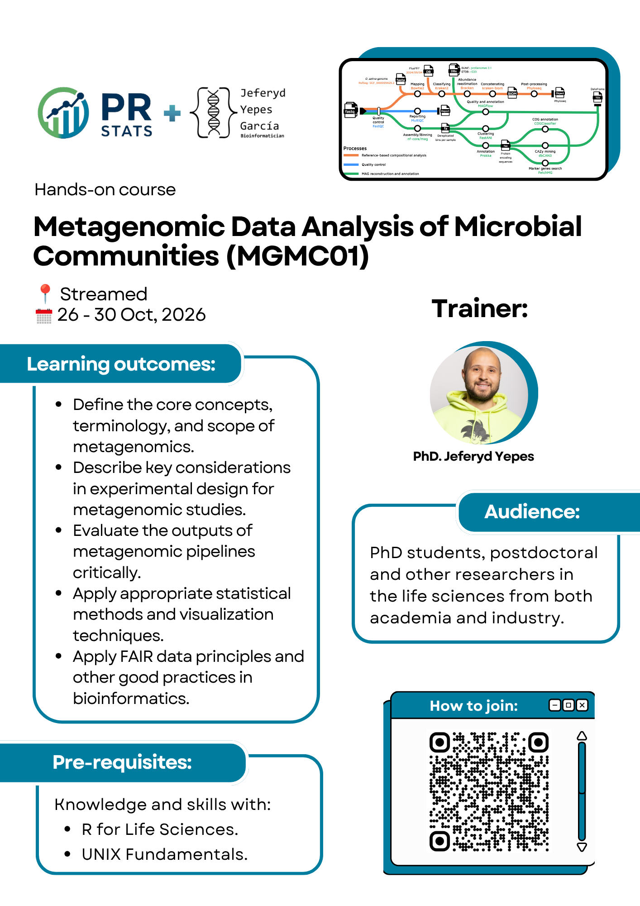

# Metagenomic Data Analysis of Microbial Communities (MGMC01)

## Course overview

??? tip "Course flyer"
    

    
    

This course covers the metagenomics data analysis workflow from data generation to downstream analysis. Participants explore the tools to manage, share, analyze and interpret metagenomics data. The content includes issues of data quality control and how to process the data until publication.

Both targeted marker-gene (e.g., 16S) and whole-genome shotgun (WGS) approaches are covered. Discussions also explore considerations when selecting the sequencing options (long or short reads), exploring targeted data to OTUs or ASVs, assembling and binning metagenomics data, available tools, and the downstream analyses that can be carried out.

## Course at a glance

* **Duration:** 5 days, two 2.5-hour sessions per day.
* **Dates:** 26–30 October 2026.
* **Format:** Online live format.
* **Time zone:** UK (GMT) local time.
* **Recordings:** All sessions will be recorded and made available to ensure accessibility for attendees across different time zones.

See the [course schedule](course_schedule.md) for the detailed programme.

## What you'll learn

After this course, you will be able to:

* Explain the core concepts of metagenomics and design a study (replication, controls, sampling, sequencing strategy), distinguishing targeted from shotgun approaches.
* Assess the quality of raw sequencing reads (Illumina short reads, PacBio long reads) and interpret FastQC reports.
* Describe marker gene selection (16S, ITS), primer design and PCR biases, and contrast OTU- and ASV-based workflows.
* Process targeted 16S amplicon (eDNA) reads with DADA2 and carry out a downstream analysis with PhyloSeq: rarefaction, α- and β-diversity, geographic mapping and LEfSe.
* Explain how sequencing depth and coverage shape shotgun metagenomics, and how k-mer- and alignment-based classifiers work.
* Understand the steps of a reference-based metagenomics pipeline (host removal, taxonomic classification with Kraken2/Bracken).
* Run a Nextflow-based metagenomics pipeline end-to-end.
* Visualize taxonomic profiles interactively with Krona plots and Pavian.
* Carry out a downstream compositional analysis with Phyloseq: α- and β-diversity, ordination and network analysis.
* Explain the principles of _de novo_ metagenome assembly and evaluate assembly quality.
* Describe binning strategies and their role in recovering MAGs.
* Perform an integral analysis of Metagenome-Assembled Genomes (MAGs): quality assessment with BUSCO/CheckM2 and BIgMAG, metabolic potential with KEGG Decoder, functional annotation (COG, CAZymes, biosynthetic gene clusters), genome visualization with Proksee and pangenome analysis.
* Apply the FAIR principles and reproducible-analysis practices (workflow managers, containers) to metagenomic datasets.

### Learning outcomes explained

To reach the general learning outcomes above, we have set a number of smaller learning outcomes. Each stage (found at [Course material](course_material/day1_introduction_quality_control.md#learning-outcomes)) starts with these smaller learning outcomes. Use these at the start of a chapter to get an idea what you will learn. Use them also at the end of a chapter to evaluate whether you have learned what you were expected to learn.

## Course format

* **Interactive learning format.** Each day features a well-balanced combination of lectures and hands-on practical exercises, with dedicated time for discussing participants' own data, time permitting.
* **Global accessibility.** All live sessions are recorded and made available on the same day, ensuring accessibility for participants across different time zones.
* **Collaborative discussions.** Open discussion sessions provide an opportunity for participants to explore specific research questions and engage with instructors and peers.
* **Comprehensive course materials.** All code, datasets, and presentation slides used during the course will be shared with participants by the instructor.
* **Personalized data engagement.** Participants are encouraged to bring their own data for discussion and practical application during the course.
* **Post-course support.** Participants will receive continued support via email for 30 days following the course, along with on-demand access to session recordings for the same period.

## Is this course right for you?

This course is designed for PhD students, postdoctoral and other researchers in the life sciences from both academia and industry who are working in the field of metagenomics and are currently in the early stages of data preparation or data analysis.

To get the most out of this course, you should meet the learning outcomes of First Steps with R in Life Sciences and the e-learning course UNIX Fundamentals.

## What you'll need for the course

* **Computer requirements.** Specifically, participants should be familiar with RStudio, how to install a library, matrix and data frame manipulation, and how to import and export data from text files. In case of doubt, evaluate your R skills with the quiz linked on the [precourse preparations](precourse.md) page before registering.
* **Software packages.** All necessary software packages will be introduced and installed during the workshop. A comprehensive list of required packages is also shared with participants ahead of the course to allow for optional pre-installation.
* **GitHub account.** We require participants to create a [GitHub account](https://github.com/signup). During the course, we will use the free tier of GitHub Codespaces in order to count with a standardized working environment for all the participants.
* **Webcam and interaction.** A working webcam is recommended to support interactive elements of the course. We encourage participants to keep their cameras on during live Zoom sessions to foster a more engaging and collaborative environment. However, if the connection is unstable, participants are kindly asked to turn them off.

!!! warning "Do not start using the Codespaces yet"
    The free tier of GitHub Codespaces has limited computing hours and storage space, and they can run out quickly. Create your account before the course, but start the Codespace only on the day of the course.

See [Precourse preparations](precourse.md) for the full setup instructions.

## Material

* This website
* Repository with files
* A workspace on GitHub Codespaces
* Repositories in Zenodo with the required data

## Acknowledgements

The material for this course is assembled from the SIB course [Introduction to Metagenomics Data Analysis of Microbial Communities](https://www.sib.swiss/training/course/20260504_MEMIC). A big portion of such course was developed by Dr. [Laurent Falquet](https://www.unifr.ch/bio/en/groups/falquet/), to whom we express our deepest gratitude.

### Exercises

Each block has practical work involved, and we'll have a discussion after each stage. All answers to the practicals are incorporated, but they are hidden. Do the exercise first by yourself, before checking out the answer. If your answer is different from the answer in the practicals, try to figure out why they are different.

### Asking questions

During lectures, you are encouraged to raise your hand if you have questions. Feel free to speak up!

**Asking questions online:**

Please use the document shared on the email to write any question you have in case you are shy to speak on the online session.